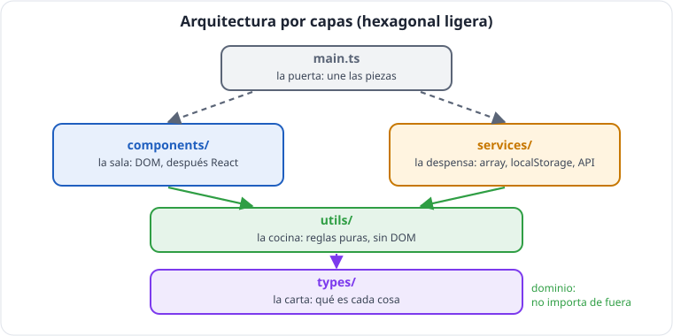
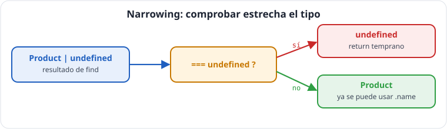

# Unidad 4 · Módulos, arquitectura por capas y tipos avanzados

*Apuntes de **Isaías FL** · Desarrollo Web en Entorno Cliente · 2.º DAW · Curso 2026‑27*

> **Qué vas a aprender:** a organizar un proyecto en varios ficheros y carpetas (módulos y capas), y las herramientas de TypeScript que hacen el código más seguro: *narrowing*, uniones discriminadas, `never`, genéricos, `keyof`, `satisfies` y *type guards*. Con ellas modelarás estados como `cargando | error | listo`, que usarás en todas las aplicaciones React.

> **Cómo leer esta unidad:** cada apartado empieza por **un problema** que seguro que te ha pasado, explica **qué es** la herramienta con palabras normales, y solo después enseña el código. Los ejemplos son pequeños y de temas distintos (notas, biblioteca, semáforo, el tiempo, mensajes...) para que te fijes en la idea y no en el proyecto. Al final de cada apartado hay una ficha para consultar.

---

## Índice

1. [Módulos: `export` e `import`](#1-módulos-export-e-import)
2. [Arquitectura por capas](#2-arquitectura-por-capas)
3. [Barriles](#3-barriles)
4. [Narrowing: la caja de herramientas](#4-narrowing-la-caja-de-herramientas)
5. [Uniones discriminadas](#5-uniones-discriminadas)
6. [`switch` exhaustivo con `never`](#6-switch-exhaustivo-con-never)
7. [Genéricos](#7-genéricos)
8. [`keyof`, `typeof`, `as const` y `satisfies`](#8-keyof-typeof-as-const-y-satisfies)
9. [Type guards: validar datos desconocidos](#9-type-guards-validar-datos-desconocidos)
10. [El tipo `Result`](#10-el-tipo-result)
11. [Autoevaluación](#11-autoevaluación)

---

## 1. Módulos: `export` e `import`

**El problema:** tu `main.ts` ya tiene 300 líneas: tipos, datos, cálculos y `console.log`, todo junto. Para encontrar una función tienes que hacer scroll durante un minuto, y si dos personas tocan el mismo fichero, chocan.

**Qué es:** un **módulo** es simplemente **un fichero `.ts`**. Todo lo que hay dentro es **privado** de ese fichero, salvo lo que marques con **`export`**. Otro fichero puede usarlo escribiendo **`import`**. Piensa en cada fichero como una **habitación con una ventanilla**: lo que pones en la ventanilla (`export`) lo pueden coger los demás; lo de dentro, no.

**Para qué sirve:** repartir el código en ficheros pequeños, cada uno con un tema, y que cada fichero diga claramente **qué ofrece** (sus `export`) y **qué necesita** (sus `import`).

### Primer ejemplo: dos ficheros

Vamos a separar en un fichero las funciones de las notas y usarlas desde `main.ts`:

```ts
// grades.ts
export function average(grades: readonly number[]): number {
  if (grades.length === 0) return 0;
  return grades.reduce((sum, g) => sum + g, 0) / grades.length;
}

function round(value: number): number {   // sin export: solo se usa aquí dentro
  return Math.round(value * 100) / 100;
}

export function roundedAverage(grades: readonly number[]): number {
  return round(average(grades));
}
```

```ts
// main.ts
import { roundedAverage } from './grades';

console.log(roundedAverage([7, 8.5, 6]));   // 7.17
// round(3.14159);   // ERROR: round no está exportada, no existe aquí
```

Léelo así:

- `export` delante de una función, un tipo o una constante = «esto se puede usar desde fuera».
- `import { roundedAverage } from './grades'` = «tráeme `roundedAverage` del fichero `grades.ts` que está **en esta misma carpeta**».
- `./` significa «esta carpeta»; `../` significa «sube una carpeta». La extensión `.ts` no se escribe.

### Importar tipos: `import type`

Si lo que traes es **solo un tipo** (una `interface`, un `type`), se escribe `import type`. Así queda claro que no es código que se ejecute, y la configuración del curso (`verbatimModuleSyntax`) lo exige.

```ts
// book.ts
export interface Book {
  readonly title: string;
  readonly author: string;
  readonly available: boolean;
}
```

```ts
// library.ts
import type { Book } from './book';   // solo un tipo → import type

export function availableBooks(list: readonly Book[]): Book[] {
  return list.filter((b) => b.available);
}
```

Si de un mismo fichero traes un valor y un tipo, hay dos formas válidas:

```ts
// (fragmento)
import { availableBooks } from './library';
import type { Book } from './book';
// o, si vienen del mismo fichero, en una línea:
// import { availableBooks, type Book } from './library';
```

### Errores típicos

| Mensaje | Qué pasa | Arreglo |
|---|---|---|
| `has no exported member 'x'` | olvidaste el `export` | añade `export` delante |
| `Cannot find module './x'` | la ruta está mal | mira en qué carpeta estás tú y en cuál está el fichero |
| `'Book' is a type and must be imported using a type-only import` | importaste un tipo sin `type` | `import type { Book }` |

### Ficha técnica · reglas del curso

| # | Regla | Por qué |
|---|---|---|
| 1 | **Exports con nombre** (`export function`), no `export default` | el nombre es único en todo el proyecto: buscar y renombrar es fiable |
| 2 | `import type` para tipos | obligatorio con `verbatimModuleSyntax`; deja claro que no es código |
| 3 | Rutas relativas sin extensión (`./`, `../`) | así resuelve Vite |
| 4 | Un fichero, una responsabilidad | fácil de encontrar y de probar |
| 5 | Los módulos **no ejecutan nada** al importarse (salvo `main.ts`) | importar no debe tener efectos inesperados |
| 6 | Sin imports circulares (A importa B y B importa A) | provocan valores `undefined` muy difíciles de rastrear |

---

## 2. Arquitectura por capas

**El problema:** ya tienes ficheros, pero ¿qué va en cada uno? Si cada persona lo decide a su manera, en un mes nadie encuentra nada. Y hay un problema peor: si los cálculos están mezclados con los `console.log`, el día que te pidan enseñar el resultado en una página web tendrás que reescribirlo todo.

**Qué es:** organizar las carpetas según **qué tipo de trabajo** hace cada fichero. Piensa en un **restaurante**:

| Restaurante | Capa | Carpeta | Qué hay | Ejemplo con notas |
|---|---|---|---|---|
| La **carta** | Tipos | `types/` | qué forma tiene cada cosa | `interface Student` |
| La **despensa** y el proveedor | Servicios | `services/` | de dónde salen los datos | hoy el array de alumnos; en la U6 `localStorage`, en la U7 `fetch` |
| La **cocina** | Lógica | `utils/` | las reglas y los cálculos | `average`, `passedStudents` |
| La **sala** | Vista | `components/` (o `main.ts` al principio) | enseñar el resultado | `console.log`, el DOM, React |
| La **puerta** | Arranque | `main.ts` | conectar todo | importa y llama |

La cocina no sabe si el plato se sirve en la terraza o en el salón: solo cocina. Igual, `utils/` **no sabe** si el resultado se verá en la consola, en una página o en una app de móvil: **solo calcula**. Por eso en `utils/` no hay ni `console.log` ni `document`.

**Por qué estos nombres:** son los que encontrarás en casi cualquier proyecto Vite + React. En noviembre, con React, se añaden `hooks/` y `pages/`, pero estas cinco piezas siguen igual.

**Para qué sirve:** que cambiar **cómo se ve** o **de dónde vienen los datos** no obligue a tocar **las reglas**. Es lo que permitirá, en noviembre, llevar `types/` y `utils/` a React **sin cambiarles una línea**.

### Primer ejemplo: las notas de la clase en tres carpetas

```
src/
├── types/
│   └── student.ts       ← carta: qué es un alumno
├── services/
│   └── students.ts      ← despensa: el array de alumnos
├── utils/
│   └── grades.ts        ← cocina: media y aprobados
└── main.ts              ← sala y puerta: enseñar resultados
```

```ts
// types/student.ts
export interface Student {
  readonly name: string;
  readonly grade: number;
}
```

```ts
// services/students.ts
import type { Student } from '../types/student';

export const students: readonly Student[] = [
  { name: 'Ana', grade: 8.5 },
  { name: 'Luis', grade: 4 },
  { name: 'Marta', grade: 6.25 },
  { name: 'Iván', grade: 9 },
  { name: 'Sara', grade: 3.5 },
];
```

```ts
// utils/grades.ts
import type { Student } from '../types/student';

export function average(list: readonly Student[]): number {
  if (list.length === 0) return 0;
  return list.reduce((sum, s) => sum + s.grade, 0) / list.length;
}

export function passedStudents(list: readonly Student[]): Student[] {
  return list.filter((s) => s.grade >= 5);
}
```

```ts
// main.ts
import { students } from './services/students';
import { average, passedStudents } from './utils/grades';

console.log(`Media: ${average(students).toFixed(2)}`);           // Media: 6.25
console.log(`Aprobados: ${passedStudents(students).length}`);    // Aprobados: 3
```

**La prueba de que funciona:** si mañana la media debe salir en una página, solo cambia `main.ts`. Si mañana los alumnos vienen de una API, solo cambia `services/students.ts`. `utils/grades.ts` **no se toca nunca** por esos motivos.

### La regla de dependencias



```
 main.ts ──▶ components/ ──┐
    │                      ▼
    ├──────▶ services/ ──▶ utils/ ──▶ types/
    │                      ▲
    └──────────────────────┘
```

> [!IMPORTANT]
> **Regla de oro:** *las flechas apuntan hacia dentro*. La sala pide a la cocina; la cocina nunca va a la sala. En código: **ningún fichero de `utils/` ni de `types/` importa de `components/` ni de `services/`**.

### ¿Dónde va cada cosa?

Hazte esta pregunta: *«¿cambiaría esta función si mañana usáramos React en vez de la consola, o si los datos vinieran de otra API?»* Si la respuesta es sí, **no va en `utils/` ni en `types/`**.

| La función... | Ejemplo | Va a |
|---|---|---|
| define qué es algo | `interface Book` | `types/` |
| calcula o decide | `average`, `isLate(loan, today)` | `utils/` |
| solo contiene datos de ejemplo | el array de libros | `services/` |
| muestra algo | `printReport`, pintar en el DOM | `components/` |
| habla con el exterior | `fetch`, `localStorage` | `services/` |

### Segundo ejemplo, para comprobar que lo has entendido: el tiempo

Una app del tiempo. Clasifica cada función antes de leer la respuesta, que va justo debajo:

1. `interface Forecast { city: string; celsius: number }`
2. `toFahrenheit(celsius: number): number`
3. `printForecast(f: Forecast): void` (hace `console.log`)
4. `loadForecast(city: string)` (hace `fetch` a una API)
5. un array con tres previsiones de prueba

**Respuesta:** 1 → `types/` (qué es). 2 → `utils/` (una regla de cálculo). 3 → `components/` (enseña). 4 → `services/` (habla con el exterior). 5 → `services/`.

> [!NOTE]
> **En la empresa** oirás: *separación de responsabilidades*, *arquitectura en capas*, *arquitectura hexagonal* (o *puertos y adaptadores*), *Clean Architecture*. Todas dicen lo mismo con distinto detalle: **el núcleo de negocio no depende de los detalles técnicos**. Nuestras carpetas son una versión ligera de la hexagonal:
>
> | Nuestra carpeta | En la hexagonal se llama | Por qué |
> |---|---|---|
> | `types/` + `utils/` | **dominio** (el núcleo) | las entidades y las reglas de negocio |
> | `services/` | **adaptador de salida** (*driven*) | conecta el núcleo con datos externos: API, `localStorage` |
> | `components/` | **adaptador de entrada** (*driving*) | el usuario entra por aquí: clics, formularios |
> | `main.ts` | **composición** | monta las piezas al arrancar |
>
> Lo que nos falta para ser hexagonal «de libro» son los **puertos**: interfaces que dicen qué necesita el núcleo (por ejemplo, `interface StudentRepository`) y que cada adaptador implementa. En el backend (Spring, NestJS) verás carpetas `domain/`, `application/` e `infrastructure/`: es la misma idea.

---

## 3. Barriles

**El problema:** `utils/` crece y tiene cinco ficheros. Desde `main.ts` acabas con cinco líneas de `import`, cada una con su ruta, y si mueves un fichero dentro de `utils/` hay que cambiar los imports de todo el proyecto.

**Qué es:** un **barril** (*barrel*) es un fichero `index.ts` dentro de una carpeta que **reexporta** lo que esa carpeta ofrece al resto. Es el **mostrador** de la carpeta: desde fuera solo se habla con el mostrador.

**Para qué sirve:** importar todo desde un solo sitio (`'./utils'`) y poder reorganizar el interior de la carpeta sin romper nada fuera.

```ts
// (fragmento) utils/index.ts — el barril
export type { Student } from '../types/student';
export type { Book } from '../types/book';
export { average, passedStudents } from './grades';
export { availableBooks } from './library';
```

```ts
// (fragmento) main.ts — antes, una línea por fichero; ahora, una sola
import { average, availableBooks, type Student } from './utils';
```

- Los **tipos** se reexportan con `export type { ... } from`.
- `from './utils'` busca automáticamente `./utils/index.ts`.
- **Dentro** de la carpeta, los ficheros se importan entre sí **directamente** (`./grades`), no a través de su propio barril: si no, se crean ciclos.

---

## 4. Narrowing: la caja de herramientas



**El problema:** una función recibe a veces un número y a veces un texto (por ejemplo, una nota que puede ser `7.5` o `'NP'`, no presentado). Si intentas hacer `nota.toFixed(1)`, TypeScript protesta: ¿y si es un texto?

```ts
function show(grade: number | string): string {
  // return grade.toFixed(1);   // ERROR: toFixed no existe en string
  return String(grade);
}
console.log(show('NP'));
```

**Qué es:** *narrowing* (estrechar) es **comprobar** qué es el valor con un `if`. Después de la comprobación, TypeScript **sabe** qué tipo es dentro de ese bloque y te deja usar sus métodos. Es como un portero que pregunta «¿eres alumno o profesor?» y, según la respuesta, te deja pasar a una puerta u otra.

**Para qué sirve:** trabajar con valores que pueden ser varias cosas (lo que devuelve `find`, lo que llega de un formulario, los errores de un `catch`) **sin mentir** a TypeScript con `as`.

### Ejemplo 1: `typeof` para primitivos

```ts
function formatGrade(grade: number | string): string {
  if (typeof grade === 'number') {
    return grade.toFixed(1);       // aquí grade es number
  }
  return grade.toUpperCase();      // por eliminación, aquí es string
}

console.log(formatGrade(7.456));   // '7.5'
console.log(formatGrade('np'));    // 'NP'
```

### Ejemplo 2: `in` para objetos distintos

Una app de mensajería: un mensaje puede ser de texto o una foto. Cada uno tiene propiedades distintas.

```ts
interface TextMessage { text: string }
interface PhotoMessage { imageUrl: string; caption: string }

function preview(message: TextMessage | PhotoMessage): string {
  if ('imageUrl' in message) {
    return `Foto: ${message.caption}`;   // aquí es PhotoMessage
  }
  return message.text;                   // aquí es TextMessage
}

console.log(preview({ text: 'Hola' }));
console.log(preview({ imageUrl: '/beach.jpg', caption: 'Playa' }));
```

### Ejemplo 3: `=== undefined` con `find`

```ts
const names = ['Ana', 'Luis', 'Marta'];
const found = names.find((n) => n.startsWith('M'));   // string | undefined

if (found === undefined) {
  console.log('Nadie empieza por M');
} else {
  console.log(found.toUpperCase());   // aquí es string
}
```

### Ejemplo 4: `instanceof` con los errores

En un `catch`, el error es de tipo **`unknown`**: en JavaScript se puede lanzar cualquier cosa (`throw 'texto'`, `throw 42`).

```ts
function errorMessage(error: unknown): string {
  if (error instanceof Error) return error.message;   // aquí es Error
  return 'Error desconocido';
}

try {
  JSON.parse('esto no es JSON');
} catch (error) {
  console.log(errorMessage(error));
}
```

### Ficha técnica · comprobaciones

| Comprobación | Distingue | Ejemplo de tipo |
|---|---|---|
| `typeof x === 'string'` | primitivos (`string`, `number`, `boolean`...) | <code>number &#124; string</code> |
| `Array.isArray(x)` | arrays | <code>string &#124; string[]</code> |
| `'prop' in x` | objetos con propiedades distintas | <code>TextMessage &#124; PhotoMessage</code> |
| `x instanceof Error` | objetos creados con clases (errores, elementos del DOM) | `unknown` en un `catch` |
| `x.kind === 'a'` | uniones discriminadas (apartado 5) | estados |
| `x === null`, `x === undefined` | ausencia de valor | `find`, `Map.get` |

> [!WARNING]
> **Atención:** `typeof null === 'object'` (un error histórico de JavaScript) y `typeof []` también es `'object'`. Para arrays, `Array.isArray`; para objetos, comprueba además `!== null`.

---

## 5. Uniones discriminadas

### El problema: estados imposibles

Vamos a modelar una **reserva de pista de pádel**. Puede estar pendiente, confirmada (con número de pista) o cancelada (con un motivo). El primer intento suele ser este:

```ts
// MAL: todo opcional permite combinaciones absurdas
interface BadBooking {
  status: 'pending' | 'confirmed' | 'cancelled';
  court?: number;     // ¿una reserva pendiente con pista?
  reason?: string;    // ¿una reserva confirmada con motivo de cancelación?
}

const nonsense: BadBooking = { status: 'pending', court: 3, reason: 'lluvia' };   // compila
console.log(nonsense.status);
```

TypeScript acepta `nonsense`, aunque no tiene sentido. Y cada vez que uses `court` tendrás que comprobar si existe, aunque la reserva esté confirmada.

### Qué es

Una **unión discriminada** es una unión de varios objetos que **comparten una propiedad con un valor fijo distinto en cada uno** (el **discriminante**, normalmente `kind`, `type` o `status`). Cada caso lleva **solo** los datos que tienen sentido en él.

Piensa en un **semáforo**: está en rojo, en ámbar o en verde, nunca en dos a la vez. Y solo en verde tiene sentido decir «cuántos segundos quedan para cruzar».

### Para qué sirve

Que los estados imposibles **no se puedan escribir**. Si un dato solo existe en un estado, TypeScript solo te deja usarlo cuando has comprobado que estás en ese estado.

### Ejemplo 1: el semáforo

```ts
type TrafficLight =
  | { color: 'red' }
  | { color: 'amber' }
  | { color: 'green'; secondsLeft: number };

function canCross(light: TrafficLight): string {
  if (light.color === 'green') {
    return `Cruza: quedan ${light.secondsLeft} s`;   // secondsLeft solo existe en verde
  }
  return 'Espera';
}

console.log(canCross({ color: 'green', secondsLeft: 12 }));
console.log(canCross({ color: 'red' }));
// canCross({ color: 'red', secondsLeft: 5 });   // ERROR: el rojo no tiene secondsLeft
```

`light.color === 'green'` es un *narrowing* (apartado 4): dentro del `if`, TypeScript sabe que es el caso verde y deja usar `secondsLeft`.

### Ejemplo 2: la reserva, bien hecha

```ts
type Booking =
  | { status: 'pending' }
  | { status: 'confirmed'; court: number }
  | { status: 'cancelled'; reason: string };

function confirm(booking: Booking, court: number): Booking {
  if (booking.status !== 'pending') return booking;   // regla: solo se confirma lo pendiente
  return { status: 'confirmed', court };
}

console.log(confirm({ status: 'pending' }, 3));          // { status: 'confirmed', court: 3 }
console.log(confirm({ status: 'cancelled', reason: 'lluvia' }, 3));   // no cambia
// const bad: Booking = { status: 'pending', court: 3 };   // ERROR: pending no tiene court
```

> [!IMPORTANT]
> **Clave:** *haz que los estados imposibles sean imposibles de escribir.*

### Ejemplo 3: el estado de carga (lo usarás siempre)

Cualquier pantalla que pide datos a internet está en uno de estos tres estados, y nunca en dos a la vez:

```ts
type WeatherState =
  | { kind: 'loading' }
  | { kind: 'error'; message: string }
  | { kind: 'ready'; celsius: number };

function weatherText(state: WeatherState): string {
  if (state.kind === 'loading') return 'Cargando...';
  if (state.kind === 'error') return `Error: ${state.message}`;
  return `${state.celsius} °C`;
}

console.log(weatherText({ kind: 'ready', celsius: 21 }));
```

En React escribirás exactamente esto para mostrar «Cargando...», un mensaje de error o los datos.

---

## 6. `switch` exhaustivo con `never`

**El problema:** el semáforo de tu ciudad añade un cuarto estado: **ámbar intermitente**. Tienes 15 funciones que hacen algo según el color. ¿Cómo sabes cuáles has olvidado actualizar?

**Qué es:** una **alarma del compilador**. Al final del `switch` se pone un `default` que solo compila si **no queda ningún caso sin tratar**. Si alguien añade un caso nuevo y no lo trata, ese `default` da error justo en la función que hay que arreglar.

**Para qué sirve:** que añadir un estado nuevo sea seguro: TypeScript te lleva de la mano por todos los sitios que hay que actualizar.

### Primer paso: el `switch`

```ts
type Light =
  | { color: 'red' }
  | { color: 'amber' }
  | { color: 'green'; secondsLeft: number };

function advice(light: Light): string {
  switch (light.color) {
    case 'red':
      return 'Párate';
    case 'amber':
      return 'Precaución';
    case 'green':
      return `Adelante (${light.secondsLeft} s)`;
    default: {
      const impossible: never = light;
      return impossible;
    }
  }
}

console.log(advice({ color: 'amber' }));
```

### Qué hace ese `default`

- `never` es el tipo «**ningún valor posible**».
- Después de `red`, `amber` y `green`, no queda ningún color: en el `default`, `light` es `never`, y la línea compila.
- Si añades `| { color: 'flashing' }` a `Light` y olvidas el `case`, en el `default` queda el caso intermitente. Como no se puede guardar en una variable `never`, TypeScript marca el error **ahí**:

```
Type '{ color: "flashing"; }' is not assignable to type 'never'.
```

Léelo como: *«te has dejado el caso `flashing`»*.

> [!WARNING]
> **Atención:** el `case` que declara variables (`const`) lleva llaves `{ }`: `case 'x': { const ... }`. Sin llaves, dos `case` con la misma `const` chocan.

---

## 7. Genéricos

**El problema:** quieres una función que devuelva el **último elemento** de una lista. Funciona igual para una lista de números, de nombres o de libros. Pero si la escribes con `number[]`, solo sirve para números; y si usas `any`, pierdes todos los tipos.

```ts
function lastNumber(list: readonly number[]): number | undefined {
  return list.at(-1);
}
function lastText(list: readonly string[]): string | undefined {
  return list.at(-1);
}
console.log(lastNumber([1, 2]), lastText(['a', 'b']));   // dos funciones idénticas
```

**Qué es:** un **genérico** es una función con **un hueco para el tipo**. Se escribe `<T>` y el hueco se rellena solo, según lo que le pases. Es como una **caja de envío**: la misma caja sirve para un libro o para unas zapatillas, y la etiqueta dice qué lleva dentro.

**Para qué sirve:** escribir **una sola** función que vale para muchos tipos **sin perder** la información del tipo.

### Primer ejemplo

```ts
function last<T>(list: readonly T[]): T | undefined {
  return list.at(-1);
}

const lastGrade = last([7, 8.5, 6]);            // T = number → number | undefined
const lastName = last(['Ana', 'Luis']);         // T = string → string | undefined
console.log(lastGrade, lastName);
```

Léelo así: *«`last` recibe una lista de **algo** (`T`) y devuelve **ese mismo algo** o `undefined`»*. TypeScript mira lo que le pasas y decide qué es `T`.

> [!IMPORTANT]
> **Clave:** *el tipo que entra decide el que sale.* `T` es solo un nombre (de *Type*); podría llamarse `Item`.

**Ya los usabas sin saberlo:** `Array<number>`, `Map<string, number>`, `Set<string>`, `Record<string, number>`, `Promise<string>`. Los `< >` son genéricos.

### Segundo ejemplo: dos huecos

Una función que empareja dos cosas, por ejemplo una ciudad con su temperatura:

```ts
function pair<A, B>(first: A, second: B): [A, B] {
  return [first, second];
}

const cityTemp = pair('Granada', 21);   // [string, number]
console.log(cityTemp);
```

### Restricciones con `extends`: «cualquier tipo que tenga...»

**El problema:** quieres `findById` para libros, alumnos y canciones. Todos tienen `id`, pero con un `T` cualquiera TypeScript no sabe que `T` tiene `id`.

```ts
function findById<T extends { id: number }>(list: readonly T[], id: number): T | undefined {
  return list.find((item) => item.id === id);
}

const songs = [
  { id: 1, title: 'Bohemian Rhapsody' },
  { id: 2, title: 'Imagine' },
];
const students = [
  { id: 10, name: 'Ana', grade: 8 },
];

console.log(findById(songs, 2)?.title);       // 'Imagine'
console.log(findById(students, 10)?.name);    // 'Ana'
// findById([1, 2, 3], 1);   // ERROR: number no tiene id
```

`T extends { id: number }` se lee: *«T puede ser **cualquier** tipo, **siempre que tenga** un `id` numérico»*. Aquí `extends` **no es herencia**: significa «que cumpla».

### Tipos genéricos

Los `type` también pueden tener huecos. El estado de carga del apartado 5, para cualquier dato:

```ts
type LoadState<T> =
  | { kind: 'loading' }
  | { kind: 'error'; message: string }
  | { kind: 'ready'; data: T };

const playlist: LoadState<string[]> = { kind: 'ready', data: ['Imagine', 'Yesterday'] };
const temperature: LoadState<number> = { kind: 'loading' };
console.log(playlist.kind, temperature.kind);
```

---

## 8. `keyof`, `typeof`, `as const` y `satisfies`

Cuatro herramientas para **sacar tipos de lo que ya tienes** en lugar de escribirlos dos veces.

### `keyof`: los nombres de las propiedades

**El problema:** una función ordena una lista de alumnos por un campo. Si el campo es un `string` cualquiera, alguien escribirá `'nota'` en vez de `'grade'` y nadie avisará.

**Qué es:** `keyof Tipo` es la unión de los **nombres** de sus propiedades.

```ts
interface Runner {
  name: string;
  minutes: number;
  age: number;
}

type RunnerField = keyof Runner;   // 'name' | 'minutes' | 'age'

function sortBy(list: readonly Runner[], field: 'minutes' | 'age'): Runner[] {
  return list.toSorted((a, b) => a[field] - b[field]);
}

const race: Runner[] = [
  { name: 'Ana', minutes: 42, age: 30 },
  { name: 'Luis', minutes: 38, age: 25 },
];
const field: RunnerField = 'minutes';
console.log(sortBy(race, field)[0]?.name);   // 'Luis'
// sortBy(race, 'nota');   // ERROR: 'nota' no es un campo válido
```

### `typeof` (en tipos): el tipo de una variable

**El problema:** ya tienes un objeto de configuración escrito y no quieres repetir su forma en una `interface`.

```ts
const settings = { theme: 'dark', fontSize: 14 };
type Settings = typeof settings;   // { theme: string; fontSize: number }

const mine: Settings = { theme: 'light', fontSize: 16 };
console.log(mine);
```

Ojo: este `typeof` va **en un tipo** (después de `type X =` o de `:`). El `typeof x === 'string'` del apartado 4 es el de JavaScript, que se ejecuta.

### `as const`: valores que no cambian

**El problema:** tienes la lista de días lectivos y quieres que el tipo sea exactamente esos cinco textos, no «cualquier `string`».

```ts
const WEEKDAYS = ['mon', 'tue', 'wed', 'thu', 'fri'] as const;
type Weekday = (typeof WEEKDAYS)[number];   // 'mon' | 'tue' | 'wed' | 'thu' | 'fri'

const today: Weekday = 'wed';
// const bad: Weekday = 'sunday';   // ERROR
console.log(today, WEEKDAYS.length);
```

- `as const` dice: «esta lista es fija y de solo lectura; recuerda cada valor exacto».
- `(typeof WEEKDAYS)[number]` se lee: «el tipo de cualquier elemento de `WEEKDAYS`».
- Ventaja: la lista (para recorrerla) y el tipo (para comprobar) salen **de un solo sitio**.

### `satisfies`: comprobar sin perder precisión

**El problema:** en una lista de tareas quieres un texto para cada estado (`todo`, `doing`, `done`) y que TypeScript avise si falta alguno. Pero si anotas el tipo con `:`, TypeScript «olvida» los valores exactos que escribiste.

```ts
type Status = 'todo' | 'doing' | 'done';

// Con satisfies: COMPRUEBA que están los tres y CONSERVA los valores exactos
const statusLabels = {
  todo: 'Por hacer',
  doing: 'En curso',
  done: 'Hecho',
} satisfies Record<Status, string>;

console.log(statusLabels.done);
// const incomplete = { todo: 'Por hacer' } satisfies Record<Status, string>;   // ERROR: faltan doing y done
```

`satisfies` **comprueba** de verdad. No lo confundas con `as`, que solo afirma:

| Sintaxis | Qué le dices a TypeScript | Veredicto |
|---|---|---|
| `x as T` | «créeme, es un T» | **no comprueba nada** |
| `x!` | «créeme, no es `null`» | evitar |
| `x satisfies T` | «comprueba que cumple T» | seguro |

---

## 9. Type guards: validar datos desconocidos

**El problema:** los tipos de TypeScript solo existen mientras escribes. Lo que llega **de fuera** (un `JSON.parse`, `localStorage`, una API) puede traer cualquier cosa: un campo que falta, un número escrito como texto... Por eso su tipo es `unknown`, y TypeScript no te deja usarlo.

```ts
const raw: unknown = JSON.parse('{"title":"Dune","pages":"muchas"}');
// console.log(raw.title);   // ERROR: raw es unknown
console.log(typeof raw);
```

**Qué es:** un **type guard** es una función que **comprueba de verdad** (en ejecución) si un valor tiene la forma esperada, y que se lo **demuestra** a TypeScript. Se reconoce por su tipo de retorno: `value is Tipo`. Es el **control de seguridad del aeropuerto**: lo que viene de fuera no entra hasta que lo revisan.

**Para qué sirve:** dejar pasar a tu código, con su tipo correcto, solo los datos que **has comprobado**. Sin `as`.

### Primer ejemplo: un type guard sencillo

```ts
function isNumber(value: unknown): value is number {
  return typeof value === 'number' && !Number.isNaN(value);
}

const mixed: unknown[] = [7, 'ocho', 9.5, null];
const onlyNumbers = mixed.filter(isNumber);   // number[]
console.log(onlyNumbers);                     // [7, 9.5]
```

Si `isNumber` devuelve `true`, TypeScript **trata el valor como `number`** a partir de ahí. Funciona también con `filter`, como ves.

### Segundo ejemplo: validar un libro que llega como JSON

```ts
interface Book {
  readonly title: string;
  readonly pages: number;
}

function isBook(raw: unknown): raw is Book {
  if (typeof raw !== 'object' || raw === null) return false;   // 1. ¿es un objeto?
  if (!('title' in raw) || !('pages' in raw)) return false;    // 2. ¿tiene los campos?
  return (                                                      // 3. ¿son del tipo correcto?
    typeof raw.title === 'string' && raw.title.trim() !== '' &&
    typeof raw.pages === 'number' && Number.isInteger(raw.pages) && raw.pages > 0
  );
}

const good: unknown = JSON.parse('{"title":"Dune","pages":612}');
const bad: unknown = JSON.parse('{"title":"Dune","pages":"muchas"}');

if (isBook(good)) console.log(good.title);   // aquí good es Book, sin "as"
console.log(isBook(bad));                    // false: pages no es un número
```

Los tres pasos se repiten siempre: **¿es un objeto? → ¿tiene los campos? → ¿son del tipo correcto?**

> [!WARNING]
> **Atención:** TypeScript **se fía** de lo que compruebes dentro. Si te olvidas de comprobar `pages`, el tipo dirá que es `number` aunque sea `"muchas"`. Comprueba **todas** las propiedades que vayas a usar.
> **En la empresa** se usan librerías como **Zod**, que generan estas comprobaciones. Hacerlo a mano te enseña qué hacen.

---

## 10. El tipo `Result`

**El problema:** una función puede fallar (el texto no es JSON, falta un dato...). Si lanza una excepción con `throw`, quien la llama puede **olvidar** el `try/catch` y la aplicación se rompe. Nada en el tipo avisa de que puede fallar.

**Qué es:** en lugar de lanzar, la función **devuelve** un objeto que dice si salió bien o mal: `{ ok: true, value }` o `{ ok: false, error }`. Es una unión discriminada (apartado 5) cuyo discriminante es `ok`. Como el **resguardo de un envío**: o pone «entregado» con la firma, o pone «no entregado» con el motivo.

**Para qué sirve:** que quien llama esté **obligado** a mirar `ok` antes de usar el valor. TypeScript no le deja acceder a `value` sin comprobarlo.

```ts
type Result<T> = { ok: true; value: T } | { ok: false; error: string };

function parseAge(text: string): Result<number> {
  const age = Number(text);
  if (text.trim() === '' || !Number.isInteger(age)) {
    return { ok: false, error: `"${text}" no es un número entero` };
  }
  if (age < 0 || age > 120) {
    return { ok: false, error: 'La edad debe estar entre 0 y 120' };
  }
  return { ok: true, value: age };
}

for (const input of ['34', 'treinta', '150']) {
  const result = parseAge(input);
  if (result.ok) {
    console.log(`Edad válida: ${result.value}`);
  } else {
    console.log(`Error: ${result.error}`);
  }
}
// Edad válida: 34 · Error: "treinta" no es un número entero · Error: La edad debe estar entre 0 y 120
```

Fíjate en las dos ideas de la U4 juntas: un **genérico** (`Result<T>` sirve para cualquier valor) y una **unión discriminada** (`ok` decide qué campos hay).

> [!NOTE]
> **En la empresa:** este patrón se llama *Result* o *Either* y es habitual en código profesional. Lo usaremos para validar formularios en la U6.

---

## 11. Autoevaluación

- [ ] ¿Qué pasa con una función de un fichero que no lleva `export`?
- [ ] ¿Cuándo se usa `import type`?
- [ ] Explica las capas con el ejemplo del restaurante. ¿Puede `utils/` importar de `components/`?
- [ ] En una app de recetas, ¿en qué capa va `scaleRecipe(recipe, people)`? ¿Y `printRecipe(recipe)`?
- [ ] ¿Qué es el «discriminante» de una unión discriminada? Pon el ejemplo del semáforo.
- [ ] ¿Para qué sirve `const impossible: never = x` en el `default` de un `switch`?
- [ ] En `function f<T extends { id: number }>`, ¿qué significa `extends`?
- [ ] ¿Qué diferencia hay entre `as` y `satisfies`?
- [ ] ¿Qué significa el tipo de retorno `raw is Book`? ¿Por qué lo que llega de `JSON.parse` es `unknown`?
- [ ] ¿Qué ventaja tiene devolver un `Result` frente a lanzar una excepción?
