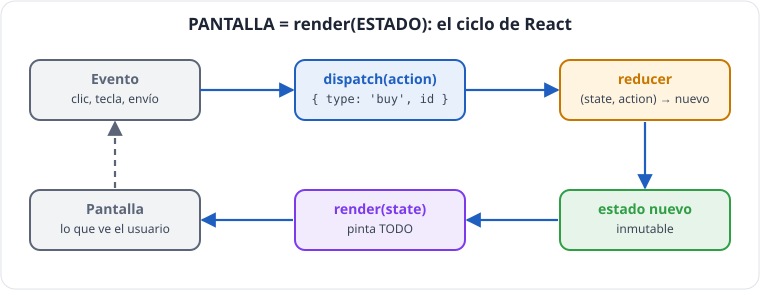
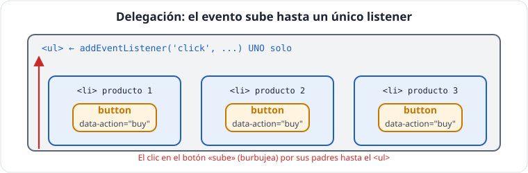

# Unidad 5 · El DOM con TypeScript: elementos, eventos y estado

*Apuntes de **Isaías FL** · Desarrollo Web en Entorno Cliente · 2.º DAW · Curso 2026‑27*

> **Qué vas a aprender:** a seleccionar elementos **comprobando** que existen y son del tipo correcto, a crear contenido de forma **segura**, a escuchar eventos con sus tipos, y el patrón que hace funcionar a React: **estado → render** con un reductor y delegación de eventos.

> **Qué vamos a construir:** hasta ahora la tienda vivía en la consola. En esta unidad la llevamos al navegador, paso a paso: primero **encontrar** los elementos del HTML, después **pintar** los productos, luego **reaccionar** a lo que hace el usuario y, por último, **ordenar** todo eso para que la pantalla nunca diga algo distinto de los datos. Al final del tema tienes la tienda completa en un solo archivo (apartado 9).

---

## Índice

1. [El DOM y sus tipos](#1-el-dom-y-sus-tipos)
2. [Seleccionar elementos con seguridad](#2-seleccionar-elementos-con-seguridad)
3. [Crear y modificar elementos](#3-crear-y-modificar-elementos)
4. [`textContent` frente a `innerHTML`: seguridad](#4-textcontent-frente-a-innerhtml-seguridad)
5. [Eventos](#5-eventos)
6. [Estado → render](#6-estado--render)
7. [Acciones y reductor](#7-acciones-y-reductor)
8. [Delegación de eventos](#8-delegación-de-eventos)
9. [Todo junto: la tienda en un archivo](#9-todo-junto-la-tienda-en-un-archivo)
10. [Autoevaluación](#10-autoevaluación)

---

## 1. El DOM y sus tipos

**El problema:** el navegador recibe un archivo de texto (el HTML), pero tu código no trabaja con texto: necesita **objetos** a los que preguntar y cambiar cosas.

**Qué es:** el **DOM** (*Document Object Model*) es el **árbol de objetos** que el navegador construye a partir del HTML. Cada etiqueta se convierte en un objeto; las etiquetas que van dentro de otra son sus **hijos**. Piensa en un árbol genealógico: `<body>` es el padre de `<header>` y de `<ul>`, y cada `<li>` es hijo de su `<ul>`.

```html
<body>
  <h1>Tienda</h1>
  <input id="search" type="search" />
  <ul id="list"></ul>
</body>
```

```
document
 └── body
      ├── h1            (texto: "Tienda")
      ├── input#search
      └── ul#list       (vacía: aquí pintaremos los productos)
```

**Para qué sirve:** todo lo que hagas en la página (leer lo que escribe el usuario, añadir productos, cambiar un color) es **leer o modificar objetos de ese árbol**. Si cambias el objeto, el navegador repinta la pantalla.

**Qué aporta TypeScript:** cada clase de elemento tiene **su propio tipo**, y cada tipo tiene propiedades distintas:

```
EventTarget                       puede recibir eventos
 └── Node                         cualquier nodo del árbol (también el texto)
      └── Element                 cualquier etiqueta
           └── HTMLElement        textContent, classList, dataset, hidden...
                ├── HTMLInputElement     .value, .checked
                ├── HTMLButtonElement    .disabled
                ├── HTMLSelectElement    .value
                ├── HTMLFormElement      .reset(), .elements
                ├── HTMLUListElement
                ├── HTMLLIElement
                └── ...
```

Cuanto más abajo en el árbol de tipos, más concreto y más propiedades tiene: solo un `HTMLInputElement` tiene `.value`. Un `Element` cualquiera no, porque un `<div>` no tiene valor. **Toda esta unidad consiste en pasar de un tipo general al tipo concreto que necesitas, comprobándolo.**

---

## 2. Seleccionar elementos con seguridad

**El problema:** tienes en el HTML un buscador y una lista vacía. ¿Cómo llega tu código TypeScript a esos elementos?

**Qué es:** **seleccionar** es pedirle al navegador una **referencia** a un elemento del DOM usando un **selector CSS**, el mismo que escribes en las hojas de estilo (`#id`, `.clase`, `etiqueta`). La referencia queda guardada en una variable y, a partir de ahí, trabajas con esa variable.

**Para qué sirve:** leer lo que escribe el usuario, pintar dentro de un contenedor y escuchar eventos. **Todo** el trabajo con la página empieza seleccionando.

### Primer intento y los dos avisos de TypeScript

Vamos a coger la lista y el buscador:

```ts
const list = document.querySelector('#list');
// tipo: Element | null
```

TypeScript nos pone dos pegas, y las dos tienen razón:

1. **Puede ser `null`.** TypeScript **no lee tu HTML**. Si el id está mal escrito (`#lista` en vez de `#list`) o el script se ejecuta antes de que exista el elemento, `querySelector` devuelve `null`. Es el mismo caso que `find` en los arrays: puede no encontrar nada.
2. **El tipo es demasiado general.** `#search` podría ser cualquier etiqueta, así que el tipo es `Element`, que no tiene `.value`.

```ts
const search = document.querySelector('#search');
// search.value;   // ERROR: 'search' is possibly 'null'
//                 // y además: Property 'value' does not exist on type 'Element'
```

### Tres formas de resolverlo, de peor a mejor

```ts
// MAL: 1. Afirmar. Compila, pero no comprueba nada
const b1 = document.querySelector('#search')! as HTMLInputElement;
```

- La **`!`** (aserción de no nulo) le dice a TypeScript: «quita el `null`, te garantizo que existe».
- **`as HTMLInputElement`** le dice: «y además te garantizo que es un input».
- Ninguna de las dos **genera código**: al compilar a JavaScript desaparecen. Son promesas que nadie comprueba.
- Si `#search` no existe, `b1` vale `null` y `b1.value` revienta **más tarde**, con `Cannot read properties of null`. Si existe pero es un `<div>`, `b1.value` vale `undefined` **sin ningún error**: el fallo es silencioso.

```ts
// OJO: 2. Genérico de querySelector. Mejor, pero sigue sin comprobar que sea un input
const b2 = document.querySelector<HTMLInputElement>('#search'); // HTMLInputElement | null
```

Ahora TypeScript sí te obliga a tratar el `null`, pero lo de «es un input» sigue siendo una promesa tuya.

```ts
// BIEN: 3. Comprobar de verdad con instanceof
const searchInput = document.querySelector('#search');
if (!(searchInput instanceof HTMLInputElement)) {
  throw new Error('Falta #search o no es un input');
}
console.log(searchInput.value);   // aquí TS sabe que es HTMLInputElement
```

`instanceof` **se ejecuta** en el navegador: pregunta al objeto real si es un input. Cubre los dos casos de una vez, porque `null instanceof HTMLInputElement` es `false`. Después del `if`, TypeScript **estrecha** el tipo (el *narrowing* de la U4) y ya deja usar `.value`.

> [!IMPORTANT]
> **Clave:** una aserción (`!`, `as`) **no valida** nada en ejecución: solo calla al compilador. Una comprobación (`instanceof`, `typeof`, `=== null`) sí. En esta unidad no usamos `as` con el DOM.

### Un helper genérico para no repetir

**El problema:** en una página real seleccionas diez elementos. Escribir el `if` con `instanceof` diez veces es repetir código.

**La idea:** una función que reciba el selector y **la clase esperada**, haga la comprobación y devuelva el elemento ya con su tipo.

```ts
function getElement<T extends Element>(selector: string, type: new () => T): T {
  const element = document.querySelector(selector);
  if (!(element instanceof type)) {
    throw new Error(`No se encuentra ${selector} o no es del tipo esperado`);
  }
  return element;
}

// Se pasa la CLASE del elemento, sin comillas
const searchField = getElement('#search', HTMLInputElement);    // HTMLInputElement
const productList = getElement('#list', HTMLUListElement);      // HTMLUListElement
console.log(searchField, productList);
```

Léelo despacio, parte a parte:

- `<T extends Element>` → `T` es «algún tipo de elemento», que se decide en cada llamada (genéricos de la U4).
- `type: new () => T` → el segundo parámetro no es un texto ni un elemento: es **una clase**, «algo que se puede construir con `new` y produce un `T`». Por eso se escribe `HTMLInputElement` **sin comillas**: es el nombre de la clase, no un texto.
- Al llamar con `HTMLInputElement`, TypeScript deduce `T = HTMLInputElement` y la función devuelve exactamente ese tipo.
- `throw` en lugar de devolver `null`: si falta un elemento del HTML, es un error **del programador**, no del usuario. Mejor que la aplicación falle **al arrancar** con un mensaje claro que a mitad de uso con uno confuso.

### Ficha técnica (para consultar)

**Ficha técnica · seleccionar**

| Método | Firma | Devuelve | Ojo |
|---|---|---|---|
| `querySelector` | `root.querySelector(selectorCss)` | el **primer** elemento que coincide, o `null`. Tipo: <code>Element &#124; null</code> (o el tipo concreto si el selector es una etiqueta: `querySelector('input')` → <code>HTMLInputElement &#124; null</code>) | selector CSS inválido → `SyntaxError` |
| `querySelectorAll` | `root.querySelectorAll(selectorCss)` | `NodeList` **estática** con todos (puede estar vacía) | no es un array: tiene `forEach` y `length`; para `map`/`filter`, `[...list]` |
| `getElementById` | `document.getElementById(id)` | <code>HTMLElement &#124; null</code> | sin `#` delante del id |
| `closest` | `element.closest(selectorCss)` | el propio elemento o el **antepasado** más cercano que coincide, o `null` | se incluye a sí mismo |
| `matches` | `element.matches(selectorCss)` | `boolean` | |

`root` puede ser `document` o cualquier elemento (busca solo dentro de él).

---

## 3. Crear y modificar elementos

**El problema:** tienes los productos en un array y una `<ul>` vacía. En el HTML no hay ninguna tarjeta: ¿cómo aparecen?

**Qué es:** **crear** un elemento es fabricarlo desde el código, en tres pasos que conviene decir siempre en voz alta:

1. **Fabricar:** `document.createElement('li')`. Existe en memoria, pero **no se ve**.
2. **Rellenar:** texto, clases, atributos.
3. **Colgar:** añadirlo como hijo de un elemento que ya está en la página. **Solo entonces aparece.**

**Para qué sirve:** pintar todo lo que depende de los datos y no está escrito en el HTML: listas, resultados de búsqueda, mensajes, el carrito. Es lo que React hará por ti.

### Primer ejemplo: un solo elemento

Vamos a construir un `<li>` con el texto «Teclado mecánico» y colgarlo en la lista:

```ts
const list = getElement('#list', HTMLUListElement);

const li = document.createElement('li');   // 1. fabricar (tipo HTMLLIElement)
li.textContent = 'Teclado mecánico';       // 2. rellenar
li.classList.add('card');
list.append(li);                           // 3. colgar: ahora sí se ve
```

Si olvidas el paso 3, no hay error: simplemente no aparece nada. Es el despiste más típico.

### Segundo paso: una tarjeta a partir de un producto

Ahora el texto no lo escribimos nosotros: sale de los **datos**. Usamos el `Product` de la tienda:

```ts
interface Product {
  readonly id: number;
  name: string;
  price: number;
  stock: number;
}

const products: readonly Product[] = [
  { id: 1, name: 'Teclado mecánico', price: 80, stock: 5 },
  { id: 2, name: 'Ratón inalámbrico', price: 25, stock: 0 },
  { id: 3, name: 'Monitor 27"', price: 220, stock: 3 },
];
```

Vamos a construir una función que **recibe un producto y devuelve su `<li>`** ya relleno. No lo cuelga: de eso se encarga quien la llame.

```ts
function createCard(p: Product): HTMLLIElement {
  const li = document.createElement('li');
  li.classList.add('card');
  li.classList.toggle('card--sold-out', p.stock === 0);   // pone la clase solo si está agotado
  li.dataset.id = String(p.id);                           // atributo data-id="1"

  const name = document.createElement('span');
  name.textContent = p.name;

  const price = document.createElement('span');
  price.textContent = `${p.price.toFixed(2)} €`;

  li.append(name, price);   // varios hijos de una vez
  return li;
}
```

Resultado para el teclado:

```html
<li class="card" data-id="1"><span>Teclado mecánico</span><span>80.00 €</span></li>
```

### Tercer paso: pintar la lista entera

```ts
function renderList(container: HTMLElement, list: readonly Product[]): void {
  if (list.length === 0) {
    const empty = document.createElement('li');
    empty.textContent = 'No hay productos que mostrar';
    container.replaceChildren(empty);
    return;
  }
  container.replaceChildren(...list.map(createCard));   // borra lo que hubiera y pone lo nuevo
}

renderList(productList, products);
```

Dos decisiones que suelen confundir:

- **¿Por qué `replaceChildren` y no `append`?** Porque vamos a llamar a `renderList` muchas veces (cada vez que el usuario filtre). Con `append`, la segunda llamada **añadiría** los productos otra vez debajo y verías la lista duplicada. `replaceChildren` **vacía y pone** en un solo paso.
- **¿Qué hace `list.map(createCard)`?** El `map` de la U2: convierte un array de **datos** en un array de **elementos**. Los `...` los pasan como argumentos sueltos. En React escribirás `products.map((p) => <Card product={p} />)`: la misma idea.

> [!TIP]
> **Consejo:** piensa siempre en el **estado vacío**. Si el filtro no encuentra nada, una pantalla en blanco parece un error; un «No hay productos» explica lo que pasa.

| Método moderno | Para qué |
|---|---|
| `append(...nodes)` | añadir al final (acepta textos) |
| `prepend(...nodes)` | añadir al principio |
| `replaceChildren(...nodes)` | sustituir todo el contenido (sin argumentos: vaciar) |
| `remove()` | quitarse a sí mismo |
| `classList.toggle(className, condición)` | poner o quitar una clase según un booleano |
| `dataset.x` | leer/escribir `data-x` (siempre texto) |

### Plantillas HTML con `<template>`

**El problema:** si la tarjeta tiene diez etiquetas, crearlas una a una con `createElement` es largo y no se ve la forma del HTML.

**Qué es:** `<template>` es una etiqueta cuyo contenido el navegador **no pinta**. Sirve de molde: lo clonas, rellenas la copia y la cuelgas.

```html
<template id="card-template">
  <li class="card"><span class="name"></span><span class="price"></span></li>
</template>
```

```ts
const template = getElement('#card-template', HTMLTemplateElement);

function createCardFromTemplate(p: Product): DocumentFragment {
  const copy = template.content.cloneNode(true);   // true: copia también los hijos
  if (!(copy instanceof DocumentFragment)) throw new Error('Plantilla inválida');

  const name = copy.querySelector('.name');
  const price = copy.querySelector('.price');
  if (name instanceof HTMLElement) name.textContent = p.name;
  if (price instanceof HTMLElement) price.textContent = `${p.price.toFixed(2)} €`;
  return copy;
}

productList.replaceChildren(...products.map(createCardFromTemplate));
```

`cloneNode` devuelve el tipo general `Node`; por eso comprobamos con `instanceof` que es un `DocumentFragment` (un «trozo de HTML» sin padre) antes de buscar dentro.

### Ficha técnica (para consultar)

**Ficha técnica · crear y modificar**

| Miembro | Firma | Devuelve | Ojo |
|---|---|---|---|
| `createElement` | `document.createElement(label)` | el elemento con su tipo exacto (`'li'` → `HTMLLIElement`) | aún no está en la página hasta que se añade |
| `append` / `prepend` | `parent.append(...nodesOrTexts)` | `undefined` | acepta textos (se añaden como texto, seguros) |
| `replaceChildren` | `parent.replaceChildren(...nodesOrTexts)` | `undefined` | sin argumentos, vacía el elemento |
| `remove` | `element.remove()` | `undefined` | se quita a sí mismo |
| `textContent` | propiedad (`string`) | lee o escribe el **texto** | al escribir, sustituye todo el contenido |
| `innerHTML` | propiedad (`string`) | lee o escribe **HTML** | riesgo de XSS con datos externos |
| `classList` | `add(...)`, `remove(...)`, `contains(c)`, `toggle(c, force?)` | `toggle` devuelve `boolean`: si la clase queda puesta | |
| `dataset` | `element.dataset.name` | <code>string &#124; undefined</code> | `data-product-id` ⟷ `dataset.productId`; **siempre texto** |
| `setAttribute` / `getAttribute` / `removeAttribute` | `el.getAttribute(name)` | `getAttribute` → <code>string &#124; null</code> | |
| `hidden` / `disabled` | propiedades `boolean` | | `disabled` solo en controles de formulario |
| `cloneNode` | `node.cloneNode(deep?)` | `Node` | `deep = true` para copiar los hijos |

---

## 4. `textContent` frente a `innerHTML`: seguridad

**El problema:** los nombres de los productos no siempre los escribes tú. Pueden venir de un formulario que rellenó otra persona o de una API.

Imagina que alguien registra un producto con este nombre:

```ts
const dangerousName = '';
const zone = document.createElement('div');

zone.textContent = dangerousName;   // BIEN: se ve el TEXTO literal, con sus < y >
// zone.innerHTML = dangerousName;  // MAL: el navegador lo INTERPRETA y ejecuta el código
console.log(zone.textContent);
```

Qué pasa con `innerHTML`, paso a paso:

1. El navegador lee el texto como **HTML** y crea una etiqueta `` de verdad.
2. Intenta cargar la imagen `x`, que no existe.
3. Al fallar, ejecuta lo que hay en `onerror`: **código de un desconocido** en el navegador de cada persona que vea ese producto.

Esto se llama **XSS** (*cross-site scripting*). En lugar de un `alert`, ese código podría leer la sesión del usuario y enviarla a otro servidor.

Con `textContent` no hay interpretación: los `<` y `>` se muestran como caracteres y no se crea ninguna etiqueta.

> [!IMPORTANT]
> **Regla:** datos del usuario o de una API, **siempre** con `textContent`. `innerHTML` solo con HTML fijo escrito por ti. React aplica esta protección automáticamente.

---

## 5. Eventos

**El problema:** la página ya pinta los productos, pero no reacciona a nada. Escribes en el buscador y no filtra; pulsas un botón y no pasa nada.

**Qué es:** un **evento** es algo que **ocurre** en la página (un clic, una tecla, el envío de un formulario) y de lo que el navegador **avisa**. Con `addEventListener` le dices: **«cuando pase esto en este elemento, llama a esta función»**. A esa función se le llama **manejador** o *listener*.

**Para qué sirve:** **toda** la interacción: botones, buscadores que filtran mientras escribes, formularios, atajos de teclado.

### Primer ejemplo: un clic

Vamos a construir un botón que cuente cuántas veces se pulsa:

```ts
const button = document.createElement('button');
button.textContent = 'Clics: 0';
document.body.append(button);
let clicks = 0;

button.addEventListener('click', (event) => {
  // event: MouseEvent (TS lo deduce por el nombre 'click')
  clicks += 1;
  button.textContent = `Clics: ${clicks}`;
  console.log(event.clientX, event.clientY);   // dónde estaba el ratón
});
```

Qué ocurre, en orden:

1. Al ejecutarse el `addEventListener`, la función **no** se ejecuta: solo se **registra**. El navegador la guarda.
2. Cada vez que el usuario pulsa, el navegador llama a la función y le pasa un **objeto evento** con los detalles (dónde, qué tecla, sobre qué elemento).
3. TypeScript sabe que `'click'` produce un `MouseEvent`, así que `event.clientX` está tipado sin que escribas nada.

### Segundo ejemplo: leer lo que escribe el usuario

El evento `input` salta **con cada letra** que se escribe o borra. Vamos a mostrar debajo del buscador lo que se está buscando:

```ts
const searchBox = getElement('#search', HTMLInputElement);
const message = document.createElement('p');
searchBox.after(message);   // lo coloca justo después del buscador

searchBox.addEventListener('input', () => {
  const text = searchBox.value.trim();
  message.textContent = text === '' ? 'Escribe para buscar' : `Buscando: ${text}`;
});
```

Fíjate en que leemos `searchBox.value`, **la variable que ya tenemos tipada**, y no `event.target.value`. El motivo, en el aviso de abajo.

### Tercer ejemplo: una casilla y la tecla Enter

```ts
const onlyInStock = getElement('#only-in-stock', HTMLInputElement);   // un checkbox

// change: salta cuando se confirma el cambio (marcar o desmarcar)
onlyInStock.addEventListener('change', () => {
  console.log(onlyInStock.checked ? 'Solo con stock' : 'Todos');
});

// keydown: salta al pulsar una tecla; event es KeyboardEvent
searchBox.addEventListener('keydown', (event) => {
  if (event.key === 'Escape') {
    searchBox.value = '';
    message.textContent = 'Búsqueda borrada';
  }
});
```

### Cuarto ejemplo: un formulario sin recargar la página

Por defecto, enviar un formulario **recarga la página** (es lo que hacía la web antes de JavaScript). Para quedarnos en la página y tratar los datos nosotros, se cancela esa acción por defecto con `preventDefault()`:

```ts
const form = getElement('#new-product', HTMLFormElement);
const nameField = getElement('#product-name', HTMLInputElement);

form.addEventListener('submit', (event) => {
  event.preventDefault();        // sin esto, la página se recarga y se pierde todo
  console.log(`Nuevo producto: ${nameField.value}`);
  form.reset();                  // vacía los campos
});
```

Los formularios se tratan a fondo en la U6.

| Evento | Cuándo | Tipo del evento |
|---|---|---|
| `click` | clic | `MouseEvent` |
| `input` | cada cambio del valor (cada letra) | `InputEvent` |
| `change` | al confirmar (checkbox, select, al salir de un input) | `Event` |
| `keydown` | tecla pulsada | `KeyboardEvent` |
| `submit` | enviar un formulario | `SubmitEvent` |

> [!WARNING]
> **Atención · pasa la función, no la ejecutes:**
> BIEN: `button.addEventListener('click', render)` → registra `render` para cada clic.
> MAL: `button.addEventListener('click', render())` → ejecuta `render` **una vez** al registrar y pasa su resultado (`undefined`) como manejador. Los clics no harán nada.

> [!WARNING]
> **Atención:** si escribes el manejador **aparte**, tipa su parámetro: `function onClick(event: MouseEvent): void`. Dentro de `addEventListener` TypeScript lo deduce; fuera, no sabe para qué evento es.

> [!WARNING]
> **Atención · `event.target`:** es el elemento donde ocurrió el evento, pero su tipo es `EventTarget | null`, que no tiene `.value`. Usa la variable del elemento que ya tienes tipada o, si no la tienes (apartado 8), compruébalo con `instanceof`.

### Opciones modernas de `addEventListener`

```ts
const eventZone = document.createElement('div');
const controller = new AbortController();

eventZone.addEventListener('click', () => console.log('solo la primera vez'), { once: true });
eventZone.addEventListener('keydown', (e) => console.log(e.key), { signal: controller.signal });

controller.abort();   // quita TODOS los listeners registrados con esa señal
```

- `{ once: true }` → el listener se quita solo después de la primera vez (un botón «Aceptar» de un aviso).
- `{ signal }` es la forma moderna de **quitar listeners** sin guardar referencias a las funciones: registras varios con la misma señal y los quitas todos con un `abort()`.

### Ficha técnica (para consultar)

**Ficha técnica · `addEventListener`**

| | |
|---|---|
| **Firma** | `target.addEventListener(type, handler, options?)` |
| **`type`** | nombre del evento sin `on`: `'click'`, `'input'`, `'submit'`... |
| **`handler`** | `(event: EventType) => void`. TS deduce el tipo por el nombre (`'click'` → `MouseEvent`) |
| **`options`** | `{ once?: boolean; signal?: AbortSignal; passive?: boolean; capture?: boolean }` |
| **Devuelve** | `undefined` |
| **Quitar** | `removeEventListener(type, sameFunction)` o, mejor, `{ signal }` + `controller.abort()` |
| **Registrar dos veces la misma función** | no la duplica (se ignora la segunda) |

**Ficha técnica · el objeto evento (`Event`)**

| Miembro | Qué es |
|---|---|
| `type` | el nombre del evento |
| `target` | el elemento **exacto** donde ocurrió (tipo <code>EventTarget &#124; null</code>) |
| `currentTarget` | el elemento que tiene el **listener** (en la delegación, el contenedor) |
| `preventDefault()` | cancela la acción por defecto (enviar formulario, seguir enlace) |
| `stopPropagation()` | impide que el evento siga subiendo a los padres (úsalo con moderación: rompe la delegación) |
| `KeyboardEvent.key` | la tecla: `'Enter'`, `'Escape'`, `'ArrowUp'`, `'a'`... |
| `MouseEvent.clientX` / `clientY` | posición del ratón |

---

## 6. Estado → render



### El problema: la pantalla miente

Con lo visto hasta aquí ya podríamos hacer una tienda: cada botón cambia el DOM directamente. Vamos a hacerlo **mal a propósito** para ver qué ocurre. Un carrito con un botón «Añadir» y un botón «Vaciar»:

```ts
// MAL: cada evento modifica la pantalla a su manera
const cartCount = document.createElement('p');
const addButton = document.createElement('button');
const clearButton = document.createElement('button');
cartCount.textContent = 'Carrito: 0';
addButton.textContent = 'Añadir';
clearButton.textContent = 'Vaciar';
document.body.append(cartCount, addButton, clearButton);

let units = 0;

addButton.addEventListener('click', () => {
  units += 1;
  cartCount.textContent = `Carrito: ${units}`;
});

clearButton.addEventListener('click', () => {
  cartCount.textContent = 'Carrito: 0';   // se ha olvidado poner units = 0
});
```

Pulsa «Añadir» tres veces, «Vaciar» y otra vez «Añadir»: la pantalla dice **«Carrito: 4»**. El dato (`units`) y lo que se ve (el texto) se han separado, porque **dos sitios distintos** escriben en la pantalla y cada uno lleva su propia cuenta.

Con dos botones el fallo se encuentra rápido. Con veinte (comprar, devolver, filtrar, vaciar, cambiar de página...) cada nuevo botón es una ocasión de olvidar actualizar algo. Es el error más común en aplicaciones web sin framework: hay **dos verdades** (los datos y el DOM) y acaban contradiciéndose.

### La solución: una sola fuente de verdad

**Qué es:** separar **lo que sabe** la aplicación de **lo que se ve**:

- El **estado** es un objeto con **toda** la información que la aplicación necesita para pintarse: qué productos hay, qué hay en el carrito, qué ha escrito el usuario en el buscador.
- **`render`** es **una** función que pinta **toda** la pantalla a partir del estado. No decide nada ni guarda nada: solo traduce datos a elementos.

```
        PANTALLA = render(ESTADO)
```

Tres reglas que hacen que funcione:

1. Los eventos **no tocan el DOM**: cambian el estado y llaman a `render`.
2. `render` pinta **todo**, no un trozo. Así no se puede olvidar nada.
3. **Nunca** se leen datos del DOM (por ejemplo, contar los `<li>` para saber cuántos productos hay): el DOM es solo un **reflejo** del estado.

> [!IMPORTANT]
> **Clave:** esta ecuación **es React**: allí se escribe `UI = f(state)`.

**Para qué sirve:** cualquier botón nuevo solo tiene que cambiar el estado; la pantalla saldrá bien sola. Y si algo se ve mal, solo hay dos sitios donde mirar: el estado (¿el dato es correcto?) o `render` (¿se pinta bien?).

### El mismo carrito, bien hecho

Vamos a reescribir el ejemplo anterior con estado y render. Mismos botones; cambia **quién** escribe en la pantalla:

```ts
// BIEN: un estado y un render
let cartUnits = 0;                     // ESTADO: la única verdad

function renderCart(): void {          // RENDER: la única que escribe en la pantalla
  cartCount.textContent = `Carrito: ${cartUnits}`;
  clearButton.disabled = cartUnits === 0;
}

addButton.addEventListener('click', () => {
  cartUnits += 1;      // 1. cambiar el estado
  renderCart();        // 2. repintar
});

clearButton.addEventListener('click', () => {
  cartUnits = 0;
  renderCart();
});

renderCart();          // primera pintura, al arrancar
```

Ahora «Vaciar» no puede dejar la pantalla desfasada: ni siquiera sabe qué texto hay que poner. Y desactivar «Vaciar» cuando el carrito está vacío ha costado una línea **en un solo sitio**.

### Paso siguiente: el contador completo con acciones

En el ejemplo anterior todavía hay algo repetido: cada evento cambia el estado **a su manera** (`+= 1`, `= 0`) y se acuerda de llamar a `renderCart`. Vamos a ordenarlo del todo. Cópialo en un `main.ts` vacío de un proyecto Vite y pruébalo:

```ts
// 1. ESTADO: toda la información, en un objeto (inmutable)
interface CounterState {
  readonly count: number;
}

// 2. ACCIONES: la lista cerrada de cosas que pueden pasar
type CounterAction = { type: 'increment' } | { type: 'reset' };

// 3. REDUCTOR: estado actual + acción → estado NUEVO (función pura, sin DOM)
function counterReducer(state: CounterState, action: CounterAction): CounterState {
  switch (action.type) {
    case 'increment':
      return { count: state.count + 1 };
    case 'reset':
      return { count: 0 };
  }
}

// 4. VISTA: los elementos se crean una vez
const output = document.createElement('p');
const incrementButton = document.createElement('button');
const resetButton = document.createElement('button');
incrementButton.textContent = 'Sumar';
resetButton.textContent = 'Reiniciar';
document.body.append(output, incrementButton, resetButton);

let state: CounterState = { count: 0 };

// render: pinta a partir del estado (nunca lee el DOM)
function render(): void {
  output.textContent = `Has pulsado ${state.count} veces`;
  resetButton.disabled = state.count === 0;
}

// dispatch: la ÚNICA forma de cambiar el estado
function dispatch(action: CounterAction): void {
  state = counterReducer(state, action);   // a) estado nuevo
  render();                                 // b) repintar
}

// 5. EVENTOS → acciones
incrementButton.addEventListener('click', () => dispatch({ type: 'increment' }));
resetButton.addEventListener('click', () => dispatch({ type: 'reset' }));

render();   // primera pintura
```

Qué pasa al pulsar «Sumar», paso a paso:

| Paso | Qué ocurre | `state` |
|---|---|---|
| Arranque | `render()` pinta «Has pulsado 0 veces» y desactiva «Reiniciar» | `{ count: 0 }` |
| Clic en «Sumar» | el listener llama a `dispatch({ type: 'increment' })` | `{ count: 0 }` |
| `dispatch` | `counterReducer` devuelve un objeto **nuevo** | `{ count: 1 }` |
| `dispatch` | llama a `render()`: «Has pulsado 1 veces», activa «Reiniciar» | `{ count: 1 }` |

Fíjate en que los eventos **no tocan el DOM** ni cambian el estado directamente: solo **dicen qué ha pasado** (una acción). Las tres piezas nuevas (acciones, reductor y `dispatch`) se explican en el apartado siguiente.

---

## 7. Acciones y reductor

**El problema:** en la tienda hay muchas formas de cambiar el estado (comprar, devolver, filtrar). Si cada listener cambia el estado a su manera, las **reglas del negocio** (no se puede comprar algo agotado, al comprar baja el stock) quedan repartidas por todo el código y repetidas.

**Qué es:**

- Una **acción** es un objeto que **describe lo que ha pasado**, sin hacerlo: `{ type: 'buy', id: 1 }` significa «el usuario quiere comprar el producto 1». Es como rellenar un pedido en papel: describe lo que quieres, pero no mueve nada del almacén.
- El **reductor** (*reducer*) es la **única** función que sabe aplicar acciones: recibe el estado actual y una acción, y **devuelve el estado nuevo**. Es el encargado del almacén que lee el pedido y decide qué cambia.
- **`dispatch`** es la ventanilla: recibe la acción, se la pasa al reductor, guarda el resultado y repinta.

```
 clic ──▶ dispatch(acción) ──▶ reducer(estado, acción) ──▶ estado nuevo ──▶ render() ──▶ pantalla
```

**Para qué sirve:** todas las reglas viven **en un solo sitio** (el reductor), y como es una función pura, se puede probar con `console.log` sin abrir el navegador.

### Paso 1: el estado y las acciones de la tienda

```ts
interface CartLine {
  readonly productId: number;
  readonly quantity: number;
}

interface ShopState {
  readonly catalog: readonly Product[];   // productos con su stock actual
  readonly cart: readonly CartLine[];     // qué hay en el carrito
  readonly filter: string;                // lo que hay escrito en el buscador
}

type Action =
  | { type: 'buy'; id: number }
  | { type: 'filter'; text: string };
```

- `ShopState` contiene **todo** lo necesario para pintar la tienda. Hasta el texto del buscador es estado: si no estuviera aquí, `render` no sabría qué filtrar.
- `Action` es una **unión discriminada** (U4): el campo `type` dice de qué acción se trata, y cada una lleva sus datos (`id` o `text`).
- Todo es `readonly`: el estado **no se modifica**, se sustituye por uno nuevo. Ahora veremos por qué.

### Paso 2: un reductor con una sola acción

Empezamos por la acción fácil, filtrar:

```ts
function reducer(state: ShopState, action: Action): ShopState {
  switch (action.type) {
    case 'filter':
      return { ...state, filter: action.text };
    // 'buy' en el paso 3
  }
  return state;
}
```

`{ ...state, filter: action.text }` se lee: «un objeto **nuevo**, copia de `state`, pero con `filter` cambiado». El `catalog` y el `cart` son los mismos de antes: no se copian, se reutilizan.

**¿Por qué no `state.filter = action.text`?** Por tres motivos:

1. `readonly` no lo permite, y es a propósito.
2. Comparar es inmediato: si `nuevo === viejo`, nada ha cambiado y no hace falta repintar. Si modificaras el objeto, siempre sería «el mismo» aunque hubiera cambiado por dentro.
3. React funciona exactamente así: si modificas el estado en lugar de sustituirlo, **no repinta**. Es el fallo número uno al empezar con React.

### Paso 3: la acción comprar, con sus reglas

Comprar tiene reglas: el producto debe existir y tener stock; al comprar, baja su stock y sube la cantidad en el carrito (o se añade una línea nueva si no estaba).

```ts
function reducer(state: ShopState, action: Action): ShopState {
  switch (action.type) {
    case 'buy': {
      // Regla: si no existe o está agotado, no cambia nada
      const product = state.catalog.find((p) => p.id === action.id);
      if (product === undefined || product.stock === 0) return state;

      // Catálogo nuevo: el producto comprado con una unidad menos, el resto igual
      const catalog = state.catalog.map((p) => (p.id === action.id ? { ...p, stock: p.stock - 1 } : p));

      // Carrito nuevo: +1 si ya estaba, línea nueva si no
      const inCart = state.cart.some((l) => l.productId === action.id);
      const cart = inCart
        ? state.cart.map((l) => (l.productId === action.id ? { ...l, quantity: l.quantity + 1 } : l))
        : [...state.cart, { productId: action.id, quantity: 1 }];

      return { ...state, catalog, cart };
    }
    case 'filter':
      return { ...state, filter: action.text };
    default: {
      const impossible: never = action;
      return impossible;
    }
  }
}
```

Las decisiones que suelen confundir:

- **`return state` cuando no se puede comprar.** Se devuelve **el mismo** objeto: así quien llama sabe que no ha cambiado nada. No es un error, es la regla de negocio.
- **`map` con un ternario** es la forma inmutable de «cambiar un elemento del array»: recorre todos, y al que coincide le devuelve una copia modificada (`{ ...p, stock: p.stock - 1 }`); a los demás, tal cual.
- **`[...state.cart, nuevaLinea]`** es la forma inmutable de `push`: un array nuevo con lo de antes más lo nuevo.
- **Las llaves `{ }` del `case 'buy'`** dan a sus `const` un bloque propio. Sin ellas, dos `case` que declaren la misma `const` chocan.
- **El `default` con `never`** (U4): si mañana añades `{ type: 'clear' }` a `Action` y olvidas su `case`, TypeScript marca error aquí. Es un recordatorio que el compilador no olvida.
- **Dentro de cada `case`, TypeScript sabe qué acción es:** en `'buy'` deja usar `action.id`; en `'filter'`, `action.text`.

### Paso 4: probar el reductor sin navegador

Como el reductor no toca el DOM, se prueba con datos y `console.log`:

```ts
let shop: ShopState = { catalog: products, cart: [], filter: '' };

shop = reducer(shop, { type: 'buy', id: 1 });
shop = reducer(shop, { type: 'buy', id: 1 });
shop = reducer(shop, { type: 'buy', id: 2 });   // agotado: no cambia nada
shop = reducer(shop, { type: 'filter', text: 'mon' });

console.log(shop.cart);                                  // [{ productId: 1, quantity: 2 }]
console.log(shop.catalog.find((p) => p.id === 1)?.stock); // 3 (tenía 5)
console.log(shop.filter);                                // 'mon'
console.log(products[0]?.stock);                         // 5: el array original no se ha tocado
```

La última línea es la prueba de la inmutabilidad: el catálogo original sigue intacto; el reductor ha ido creando versiones nuevas.

### Paso 5: `dispatch`, la única puerta

```ts
// (fragmento) La ÚNICA forma de cambiar el estado
function dispatch(action: Action): void {
  state = reducer(state, action);
  render();
}
```

Los listeners ya no saben nada de stock ni de carritos: solo **anuncian** qué ha pasado.

```ts
// (fragmento)
searchInput.addEventListener('input', () => dispatch({ type: 'filter', text: searchInput.value }));
```

Resumen:

- El reductor es **puro**: mismo estado y misma acción → mismo resultado; no toca el DOM ni variables de fuera.
- Si nada cambia, devuelve **el mismo** objeto: así se sabe que no hay que repintar.
- Las reglas de negocio viven en **un solo sitio**.

> [!NOTE]
> **En la empresa:** este patrón se llama **reducer**: es el de **Redux** y el del hook **`useReducer`** de React. Lo que acabas de escribir es Redux sin librería.

---

## 8. Delegación de eventos



### El problema: los botones nacen y mueren en cada render

Cada tarjeta de producto tiene ahora un botón «Añadir». Lo natural sería ponerle un listener a cada uno al crearlo. Pero recuerda que `render` usa `replaceChildren`: **cada vez que se pinta, los botones se borran y se crean otros nuevos**. Habría que volver a registrar todos los listeners en cada render, y además cada botón necesitaría saber a qué producto pertenece.

### Qué es: un solo listener en el padre

Cuando pulsas un botón, el evento **no se queda en el botón**: **sube** (*burbujea*) por todos sus antepasados, uno a uno, hasta `document`:

```
 clic en <button> ─▶ <li> ─▶ <ul id="list"> ─▶ <body> ─▶ document
                              ▲
                              aquí ponemos UN listener
```

La **delegación** aprovecha esto: en lugar de un listener por botón, se pone **uno solo** en el contenedor (`<ul>`), que **no se borra nunca**, y al recibir el clic se pregunta **qué botón** lo originó. Es como el conserje de un edificio: no hay un buzón por visitante, todas las cartas llegan a portería y el conserje mira el nombre del sobre.

Puedes comprobar que el evento sube con este ejemplo mínimo:

```ts
const outer = document.createElement('ul');
const inner = document.createElement('li');
inner.textContent = 'Púlsame';
outer.append(inner);
document.body.append(outer);

outer.addEventListener('click', (event) => {
  console.log('target:', event.target);              // el <li>: donde se hizo clic
  console.log('currentTarget:', event.currentTarget); // el <ul>: quien tiene el listener
});
```

Pulsas el `<li>`, pero salta el listener del `<ul>`. Por eso existen dos propiedades: `target` (dónde se hizo clic) y `currentTarget` (quién está escuchando).

**Para qué sirve:** listas que cambian (productos, carrito, tareas), tablas con botones de editar y borrar... cualquier zona cuyos elementos se crean y se destruyen.

### Paso 1: el botón lleva escrito qué hace y sobre qué

El listener del `<ul>` necesita saber dos cosas del botón pulsado: **qué acción** es y **sobre qué producto**. Se guardan en atributos `data-*` al crear el botón:

```ts
function createButton(text: string, action: string, id: number): HTMLButtonElement {
  const b = document.createElement('button');
  b.type = 'button';
  b.textContent = text;
  b.dataset.action = action;     // data-action="buy"
  b.dataset.id = String(id);     // data-id="4"  (los data-* son siempre texto)
  return b;
}
```

```html
<button type="button" data-action="buy" data-id="4">Añadir</button>
```

### Paso 2: el listener averigua qué se pulsó

```ts
function onButtonClick(event: MouseEvent): void {
  if (!(event.target instanceof Element)) return;
  const button = event.target.closest('button[data-action]');   // sube hasta un botón con data-action
  if (!(button instanceof HTMLButtonElement)) return;             // se pulsó fuera de un botón
  const id = Number(button.dataset.id);                           // texto → número
  if (!Number.isInteger(id)) return;                              // validar
  if (button.dataset.action === 'buy') dispatch({ type: 'buy', id });
}

productList.addEventListener('click', onButtonClick);
```

Línea a línea:

1. `event.target` es `EventTarget | null`. Con `instanceof Element` comprobamos que es una etiqueta, para poder usar `closest`.
2. `closest('button[data-action]')` sube desde el elemento pulsado hasta encontrar un botón con `data-action`. Si el botón tiene un icono dentro y se pulsa el icono, `target` es el icono: `closest` sube hasta el botón. Si se pulsó en el nombre del producto, no hay botón en el camino y devuelve `null`.
3. `instanceof HTMLButtonElement` descarta ese `null`.
4. `Number(button.dataset.id)`: los `data-*` **siempre son texto**. Esto es **conversión**, no validación.
5. `Number.isInteger(id)` sí es **validación**: si faltaba `data-id`, `Number(undefined)` da `NaN` y se descarta.
6. Con todo comprobado, se **despacha** la acción. El listener no compra nada: avisa al reductor.

Tres comprobaciones y ningún `as`. En internet verás `(e.target as HTMLButtonElement).dataset.id!`: compila, pero si se pulsa el icono de dentro del botón, `target` es el icono y falla **en silencio**.

> **Ojo TypeScript:** `onButtonClick` está escrita **aparte**, así que su parámetro **sí** hay que tiparlo (`event: MouseEvent`). Al pasarla a `addEventListener('click', ...)`, TS comprueba que encaja.

---

## 9. Todo junto: la tienda en un archivo

Ahora juntamos todas las piezas de la unidad en un ejemplo que funciona. En el proyecto de clase están separadas en capas (`utils/`, `components/`, `main.ts`); aquí van en un solo archivo para leerlo de arriba abajo.

**HTML (`index.html`):**

```html
<input id="search" type="search" placeholder="Buscar producto…" />
<h2>Catálogo</h2>
<ul id="list"></ul>
<h2>Carrito</h2>
<ul id="cart"></ul>
<p id="total"></p>
<script type="module" src="/src/main.ts"></script>
```

**TypeScript (`src/main.ts`):**

```ts
// ---------- DATOS ----------
interface Product {
  readonly id: number;
  name: string;
  price: number;
  stock: number;
}

const initialProducts: readonly Product[] = [
  { id: 1, name: 'Teclado mecánico', price: 80, stock: 5 },
  { id: 2, name: 'Ratón inalámbrico', price: 25, stock: 0 },
  { id: 3, name: 'Monitor 27"', price: 220, stock: 3 },
  { id: 4, name: 'Auriculares', price: 60, stock: 10 },
];

// ---------- ESTADO Y ACCIONES (puro: sin DOM) ----------
interface CartLine {
  readonly productId: number;
  readonly quantity: number;
}

interface ShopState {
  readonly catalog: readonly Product[];
  readonly cart: readonly CartLine[];
  readonly filter: string;
}

type Action =
  | { type: 'buy'; id: number }
  | { type: 'return'; id: number }
  | { type: 'filter'; text: string };

function changeStock(catalog: readonly Product[], id: number, delta: number): readonly Product[] {
  return catalog.map((p) => (p.id === id ? { ...p, stock: p.stock + delta } : p));
}

function reducer(state: ShopState, action: Action): ShopState {
  switch (action.type) {
    case 'buy': {
      const product = state.catalog.find((p) => p.id === action.id);
      if (product === undefined || product.stock === 0) return state;
      const inCart = state.cart.some((l) => l.productId === action.id);
      return {
        ...state,
        catalog: changeStock(state.catalog, action.id, -1),
        cart: inCart
          ? state.cart.map((l) => (l.productId === action.id ? { ...l, quantity: l.quantity + 1 } : l))
          : [...state.cart, { productId: action.id, quantity: 1 }],
      };
    }
    case 'return': {
      const line = state.cart.find((l) => l.productId === action.id);
      if (line === undefined) return state;
      return {
        ...state,
        catalog: changeStock(state.catalog, action.id, +1),
        cart:
          line.quantity === 1
            ? state.cart.filter((l) => l.productId !== action.id)
            : state.cart.map((l) => (l.productId === action.id ? { ...l, quantity: l.quantity - 1 } : l)),
      };
    }
    case 'filter':
      return { ...state, filter: action.text };
    default: {
      const impossible: never = action;
      return impossible;
    }
  }
}

function filterByText(catalog: readonly Product[], text: string): readonly Product[] {
  const search = text.trim().toLowerCase();
  return catalog.filter((p) => p.name.toLowerCase().includes(search));
}

// ---------- VISTA ----------
function getElement<T extends Element>(selector: string, type: new () => T): T {
  const element = document.querySelector(selector);
  if (!(element instanceof type)) {
    throw new Error(`No se encuentra ${selector} o no es del tipo esperado`);
  }
  return element;
}

const searchInput = getElement('#search', HTMLInputElement);
const list = getElement('#list', HTMLUListElement);
const cartList = getElement('#cart', HTMLUListElement);
const total = getElement('#total', HTMLParagraphElement);

function createButton(text: string, action: Action['type'], id: number): HTMLButtonElement {
  const b = document.createElement('button');
  b.type = 'button';
  b.textContent = text;
  b.dataset.action = action;
  b.dataset.id = String(id);
  return b;
}

function createCard(p: Product): HTMLLIElement {
  const li = document.createElement('li');
  li.textContent = `${p.name} · ${p.price.toFixed(2)} € · stock ${p.stock} `;
  const buy = createButton('Añadir', 'buy', p.id);
  buy.disabled = p.stock === 0;
  li.append(buy);
  return li;
}

function createCartLine(line: CartLine, catalog: readonly Product[]): HTMLLIElement {
  const product = catalog.find((p) => p.id === line.productId);
  const li = document.createElement('li');
  li.textContent = `${product?.name ?? 'Desconocido'} × ${line.quantity} `;
  li.append(createButton('−', 'return', line.productId));
  return li;
}

function emptyItem(text: string): HTMLLIElement {
  const li = document.createElement('li');
  li.textContent = text;
  return li;
}

// ---------- EL CICLO ----------
// 1. UNA sola fuente de verdad
let state: ShopState = { catalog: initialProducts, cart: [], filter: '' };

// 2. render: pinta TODO a partir del estado. No lee nada del DOM
function render(): void {
  const visible = filterByText(state.catalog, state.filter);
  list.replaceChildren(...(visible.length > 0 ? visible.map(createCard) : [emptyItem('Sin resultados')]));

  cartList.replaceChildren(
    ...(state.cart.length > 0
      ? state.cart.map((line) => createCartLine(line, state.catalog))
      : [emptyItem('El carrito está vacío')]),
  );

  const amount = state.cart.reduce((sum, line) => {
    const product = state.catalog.find((p) => p.id === line.productId);
    return sum + (product?.price ?? 0) * line.quantity;
  }, 0);
  total.textContent = `Total: ${amount.toFixed(2)} €`;
}

// 3. dispatch: la ÚNICA forma de cambiar el estado
function dispatch(action: Action): void {
  const next = reducer(state, action);
  if (next === state) return;   // nada ha cambiado: no hace falta repintar
  state = next;
  render();
}

// 4. Delegación: UN listener por zona, para todos sus botones
function onButtonClick(event: MouseEvent): void {
  if (!(event.target instanceof Element)) return;
  const button = event.target.closest('button[data-action]');
  if (!(button instanceof HTMLButtonElement)) return;
  const id = Number(button.dataset.id);
  if (!Number.isInteger(id)) return;
  if (button.dataset.action === 'buy') dispatch({ type: 'buy', id });
  if (button.dataset.action === 'return') dispatch({ type: 'return', id });
}

list.addEventListener('click', onButtonClick);
cartList.addEventListener('click', onButtonClick);
searchInput.addEventListener('input', () => dispatch({ type: 'filter', text: searchInput.value }));

render();   // primera pintura
```

**Resultado esperado:**

- Al arrancar: cuatro productos; «Añadir» del ratón desactivado (stock 0); «El carrito está vacío»; «Total: 0.00 €».
- Dos clics en «Añadir» del teclado: su stock pasa a 3, el carrito muestra «Teclado mecánico × 2» y el total, «160.00 €».
- Un clic en «−»: vuelve a × 1 y el stock a 4. Otro clic: la línea desaparece.
- Escribir «mon» en el buscador: solo queda el monitor. Escribir «zzz»: «Sin resultados».

**Casos límite que ya están cubiertos, y dónde:**

| Caso | Quién lo resuelve |
|---|---|
| Comprar algo agotado | el reductor devuelve el mismo estado; además, el botón está desactivado |
| Devolver algo que no está en el carrito | el reductor devuelve el mismo estado |
| Clic en el texto de una tarjeta, fuera del botón | `closest` devuelve `null` y el listener sale |
| Un `data-id` que falta o no es un número | `Number.isInteger` lo descarta |
| Falta un id en el HTML | `getElement` lanza un error claro al arrancar |
| Un nombre de producto con HTML dentro | `textContent` lo muestra como texto (sin XSS) |

> [!IMPORTANT]
> **Clave:** fíjate en las cuatro piezas numeradas en los comentarios del ciclo. **Estado**, **render**, **dispatch** y **eventos que solo despachan acciones**. En React, `useReducer` te da el estado y `dispatch`; el componente es tu `render`; y los botones llevan `onClick={() => dispatch(...)}`. La delegación la hace React por ti.

---

## 10. Autoevaluación

- [ ] ¿Qué es el DOM y por qué TypeScript tiene un tipo distinto para cada etiqueta?
- [ ] ¿Qué tipo devuelve `document.querySelector('#x')`? ¿Por qué puede ser `null`?
- [ ] ¿Qué hace la `!` en `querySelector('#x')!` y por qué no protege de nada en ejecución?
- [ ] ¿Por qué `querySelector<HTMLInputElement>(...)` no es una comprobación real?
- [ ] ¿Qué tres pasos hacen falta para que un elemento creado aparezca en pantalla?
- [ ] ¿Por qué `render` usa `replaceChildren` y no `append`?
- [ ] ¿Por qué `textContent` y no `innerHTML` para mostrar el nombre que escribe un usuario?
- [ ] ¿Qué falla en `button.addEventListener('click', render())`?
- [ ] ¿Para qué sirve `event.preventDefault()` en un `submit`?
- [ ] En el carrito «mal hecho» del apartado 6, ¿por qué la pantalla acaba diciendo 4?
- [ ] Completa: `PANTALLA = ______(ESTADO)`.
- [ ] ¿Qué diferencia hay entre una acción y el reductor? ¿Qué hace `dispatch`?
- [ ] ¿Por qué el reductor devuelve un objeto nuevo en lugar de modificar `state`?
- [ ] ¿Por qué ponemos el listener en el `<ul>` y no en cada botón? ¿Qué diferencia hay entre `target` y `currentTarget`?
