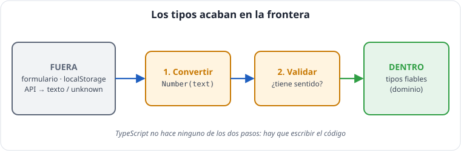

# Unidad 6 · Formularios, validación y persistencia

*Apuntes de **Isaías FL** · Desarrollo Web en Entorno Cliente · 2.º DAW · Curso 2026‑27*

> **Qué vas a aprender:** a leer lo que el usuario escribe en un formulario, a **convertirlo y validarlo** antes de usarlo, a enseñarle sus errores campo a campo y a **recordar datos** aunque recargue la página con `localStorage`.
> **La idea de toda la unidad cabe en una frase:** *lo que llega de fuera no es de fiar hasta que tú lo compruebas.*

---

## Índice

1. [El problema: el usuario siempre escribe texto](#1-el-problema-el-usuario-siempre-escribe-texto)
2. [El formulario y el evento `submit`](#2-el-formulario-y-el-evento-submit)
3. [Leer el formulario con `FormData`](#3-leer-el-formulario-con-formdata)
4. [Convertir no es validar](#4-convertir-no-es-validar)
5. [Validar en el dominio](#5-validar-en-el-dominio)
6. [Enseñar los errores](#6-enseñar-los-errores)
7. [`localStorage`: que no se pierda al recargar](#7-localstorage-que-no-se-pierda-al-recargar)
8. [Guardar listas y objetos: JSON](#8-guardar-listas-y-objetos-json)
9. [Cargar con desconfianza](#9-cargar-con-desconfianza)
10. [Fichas técnicas](#10-fichas-técnicas)
11. [Autoevaluación](#11-autoevaluación)

---

## 1. El problema: el usuario siempre escribe texto

Imagina un formulario que pregunta la edad. El usuario escribe `17` y tu código suma 1 para saber cuántos años cumplirá:

```ts
const typedAge = '17';            // lo que llega del <input>: SIEMPRE texto
console.log(typedAge + 1);        // "171"  ← ¡ha pegado un 1, no ha sumado!
console.log(Number(typedAge) + 1); // 18    ← primero hay que convertir
```

Aunque el campo sea `<input type="number">`, lo que lees desde el código es **texto**. Y además el usuario puede escribir cualquier cosa: nada, `diecisiete`, `-4`, `17,5`...

Esto pasa en todas las **fronteras** de una aplicación, los sitios por donde entran datos de fuera:

| Por dónde entra | Qué llega de verdad |
|---|---|
| Un formulario | texto (`string`) |
| `localStorage` | texto, o `null` si no hay nada |
| `JSON.parse` | `any`: TypeScript no sabe qué es |
| Una API (unidad 7) | `any` |

> [!IMPORTANT]
> **Clave:** TypeScript comprueba tu código **antes** de ejecutarlo. No puede saber qué escribirá el usuario mañana. Por eso en la frontera hay que **convertir** y **validar** con código que se ejecuta de verdad.



---

## 2. El formulario y el evento `submit`

**El problema:** el club de pádel quiere que los jugadores se apunten al torneo desde la web, en vez de mandar un mensaje.

**Qué es:** un `<form>` agrupa los campos que rellena el usuario. Cuando pulsa el botón de enviar (o Enter dentro de un campo), el formulario lanza el evento **`submit`**.

**Para qué sirve:** para cualquier dato que escribe el usuario: inscripciones, búsquedas, comentarios, inicio de sesión.

```html
<form id="signup-form" novalidate>
  <label>Nombre <input name="name" /></label>
  <small data-error-for="name"></small>

  <label>Edad <input name="age" inputmode="numeric" /></label>
  <small data-error-for="age"></small>

  <label>Nivel
    <select name="level">
      <option value="">— Elige —</option>
      <option value="beginner">Iniciación</option>
      <option value="intermediate">Intermedio</option>
      <option value="advanced">Avanzado</option>
    </select>
  </label>
  <small data-error-for="level"></small>

  <label><input type="checkbox" name="rules" /> Acepto las normas del torneo</label>
  <small data-error-for="rules"></small>

  <button type="submit">Inscribirme</button>
</form>
```

Tres detalles del HTML:

- **`name="..."`** es el nombre con el que leeremos cada campo. Un campo sin `name` no se lee.
- **`novalidate`** apaga los mensajes automáticos del navegador: los mensajes los pondremos nosotros, en español y donde queramos.
- **`<small data-error-for="age">`** es el hueco donde escribiremos el error de ese campo.

Y en TypeScript escuchamos el `submit` **del formulario**:

```ts
const form = document.querySelector('#signup-form');
if (!(form instanceof HTMLFormElement)) throw new Error('Falta #signup-form');

form.addEventListener('submit', (event) => {
  event.preventDefault();   // ¡la primera línea, siempre!
  console.log('Han pulsado Inscribirme');
});
```

**¿Por qué `preventDefault()`?** Lo que hace un formulario por defecto es **enviarse y recargar la página**. Si no lo evitas, la página se recarga, tu código se pierde y parece que «no hace nada».

**¿Por qué `submit` y no `click` en el botón?** Porque `submit` salta también cuando el usuario pulsa **Enter**. Con `click` en el botón, Enter no haría nada.

---

## 3. Leer el formulario con `FormData`

**El problema:** el formulario tiene cuatro campos. Buscarlos uno a uno con `querySelector` es pesado.

**Qué es:** `FormData` es un objeto que el navegador rellena con **todos los campos** del formulario, usando su `name` como clave.

**El ejemplo:**

```ts
const data = new FormData(form);
console.log(data.get('name'));   // "Lucía"
console.log(data.get('age'));    // "17"      ← texto
console.log(data.get('level'));  // "advanced"
console.log(data.get('rules'));  // "on" si está marcado, null si no
```

`data.get(...)` puede devolver tres cosas: un **texto**, un **archivo** (`File`, si el campo es de subir ficheros) o **`null`** (si no existe ese campo). Para trabajar cómodos, hacemos una pequeña función que siempre devuelva texto:

```ts
function text(data: FormData, field: string): string {
  const value = data.get(field);
  return typeof value === 'string' ? value : '';   // si no es texto, cadena vacía
}
```

Y con ella leemos el formulario entero en un objeto. Todo es texto, y eso es **honesto**: es lo que llega de verdad.

```ts
interface SignupForm {
  name: string;
  age: string;      // texto, aunque sea una edad
  level: string;
  rules: boolean;   // la casilla: marcada o no
}

function readSignup(form: HTMLFormElement): SignupForm {
  const data = new FormData(form);
  return {
    name: text(data, 'name'),
    age: text(data, 'age'),
    level: text(data, 'level'),
    rules: data.get('rules') !== null,   // un checkbox desmarcado NO aparece en FormData
  };
}
```

> **Ojo con los checkbox:** si la casilla está desmarcada, `FormData` ni la incluye. Por eso se pregunta «¿existe?» (`!== null`).

---

## 4. Convertir no es validar

Son dos pasos distintos, y se hacen en este orden:

```
 TEXTO  ──1. CONVERTIR──▶  número  ──2. VALIDAR──▶  ¿tiene sentido?  ──▶  USAR
 "17"       Number(...)       17         entre 8 y 99       sí
```

- **Convertir** es cambiar el tipo: de `"17"` a `17`.
- **Validar** es comprobar que el valor **tiene sentido para tu aplicación**. `-4` es un número perfecto para JavaScript, pero no es una edad.

Tres ejemplos distintos para verlo:

| Dato | Convertir | Validar |
|---|---|---|
| Edad `"17"` | `Number("17")` → `17` | ¿es entero y está entre 8 y 99? |
| Temperatura `"21,5"` | `Number("21,5".replace(',', '.'))` → `21.5` | ¿está entre −50 y 60? |
| Fecha de reserva `"2026-11-03"` | `new Date("2026-11-03")` | ¿es hoy o más adelante? |

### Las trampas de convertir

`Number` es la herramienta, pero tiene sorpresas. Pruébalas en la consola:

```ts
console.log(Number('17'));        // 17
console.log(Number(''));          // 0    ← ¡un campo VACÍO parece un cero!
console.log(Number('   '));       // 0    ← espacios: también cero
console.log(Number('21,5'));      // NaN  ← no entiende la coma española
console.log(Number('17 años'));   // NaN  ← bien: no acepta basura
console.log(parseInt('17 años')); // 17   ← mal: parseInt se come la basura
```

`NaN` significa *Not a Number*: «esto no es un número». Se detecta con `Number.isNaN(x)`, o mejor con `Number.isFinite(x)`, que también descarta `Infinity`.

> [!IMPORTANT]
> **Regla práctica:**
> 1. Comprueba primero si el campo está **vacío** (`texto.trim() === ''`).
> 2. Convierte con **`Number`**, no con `parseInt`.
> 3. Comprueba con **`Number.isFinite`** (cualquier número) o **`Number.isInteger`** (sin decimales).

---

## 5. Validar en el dominio

**El problema:** si metemos todas las comprobaciones dentro del `submit`, mezclamos la página con las reglas. Las reglas del torneo («mínimo 8 años») no dependen de la página: valen igual para una app de móvil.

**Qué hacemos:** una función de **dominio** (sin DOM, sin `document`) que recibe el texto del formulario y devuelve una de dos cosas:

- **todo bien**, con los datos ya convertidos;
- **algo mal**, con un mensaje por cada campo que falla.

```ts
type Level = 'beginner' | 'intermediate' | 'advanced';

interface Player {           // el dato BUENO: ya con sus tipos de verdad
  name: string;
  age: number;
  level: Level;
}

type SignupErrors = Partial<Record<'name' | 'age' | 'level' | 'rules', string>>;

type SignupResult =
  | { ok: true; player: Player }
  | { ok: false; errors: SignupErrors };
```

`SignupErrors` se lee: «un objeto que **puede** tener un mensaje para `name`, para `age`, para `level` o para `rules`». `Partial` hace que todas sean opcionales: solo aparecen las que fallan.

```ts
const LEVELS: readonly Level[] = ['beginner', 'intermediate', 'advanced'];

function isLevel(value: string): value is Level {
  return LEVELS.some((level) => level === value);
}

function validateSignup(form: SignupForm): SignupResult {
  const errors: SignupErrors = {};

  const name = form.name.trim();
  if (name.length < 2) errors.name = 'Escribe tu nombre';

  const age = Number(form.age);                                   // 1. convertir
  if (form.age.trim() === '' || !Number.isInteger(age) || age < 8 || age > 99) {
    errors.age = 'Edad entre 8 y 99 años';                         // 2. validar
  }

  if (!isLevel(form.level)) errors.level = 'Elige tu nivel';
  if (!form.rules) errors.rules = 'Tienes que aceptar las normas';

  if (Object.keys(errors).length > 0 || !isLevel(form.level)) {
    return { ok: false, errors };
  }
  return { ok: true, player: { name, age, level: form.level } };
}
```

**Pruébalo sin navegador**, que es la gran ventaja de tenerlo en el dominio:

```ts
console.log(validateSignup({ name: 'L', age: '', level: '', rules: false }));
// { ok: false, errors: { name: 'Escribe tu nombre', age: 'Edad entre 8 y 99 años',
//                        level: 'Elige tu nivel', rules: 'Tienes que aceptar las normas' } }

console.log(validateSignup({ name: 'Lucía', age: '17', level: 'advanced', rules: true }));
// { ok: true, player: { name: 'Lucía', age: 17, level: 'advanced' } }
```

Fíjate en tres decisiones:

- **Se acumulan todos los errores.** El usuario ve de una vez todo lo que tiene que corregir, en vez de ir error a error.
- **`trim()`** quita espacios de los lados: `"  Lucía "` pasa a `"Lucía"`, y `"   "` pasa a `""`.
- **¿Por qué se repite `!isLevel(form.level)` al final?** Porque TypeScript no deduce que «`errors` vacío» signifique «el nivel es válido». La comprobación directa le confirma que `form.level` es un `Level`, y así no hace falta ningún `as`.

---

## 6. Enseñar los errores

Ahora la vista: escribir cada mensaje en su `<small data-error-for="...">` y marcar el campo.

```ts
const FIELDS = ['name', 'age', 'level', 'rules'] as const;

function showErrors(form: HTMLFormElement, errors: SignupErrors): void {
  for (const field of FIELDS) {
    const message = errors[field] ?? '';                       // sin error → texto vacío
    const output = form.querySelector(`[data-error-for="${field}"]`);
    if (output instanceof HTMLElement) output.textContent = message;

    const input = form.elements.namedItem(field);
    if (input instanceof HTMLInputElement || input instanceof HTMLSelectElement) {
      input.setAttribute('aria-invalid', String(message !== ''));
    }
  }
}
```

`aria-invalid="true"` hace que un lector de pantalla avise de que el campo está mal, y con una línea de CSS se pone en rojo:

```css
[aria-invalid="true"] { border-color: #dc2626; }
```

**Todo junto en el `submit`.** Léelo como una receta de cuatro pasos:

```ts
form.addEventListener('submit', (event) => {
  event.preventDefault();                          // 1. que no se recargue

  const result = validateSignup(readSignup(form)); // 2. leer y validar

  if (!result.ok) {
    showErrors(form, result.errors);               // 3a. mal: enseñar errores
    return;
  }

  showErrors(form, {});                            // 3b. bien: limpiar errores viejos
  console.log(`Inscrito: ${result.player.name}`);  // 4. usar el dato bueno
  form.reset();                                    //    y vaciar el formulario
});
```

Dentro del `if (!result.ok)`, TypeScript sabe que existe `result.errors`. Después del `return`, sabe que existe `result.player`. Es la **unión discriminada** de la U4 trabajando para ti.

---

## 7. `localStorage`: que no se pierda al recargar

**El problema:** la página tiene un botón de modo oscuro. El usuario lo activa, recarga... y vuelve el modo claro. Todo lo que guardas en variables **se pierde al recargar**.

**Qué es:** `localStorage` es un pequeño almacén del navegador donde guardas **texto** con un nombre (una clave). Sigue ahí aunque recargues o cierres el navegador.

**Para qué sirve:** recordar cosas pequeñas del usuario: el tema, el idioma, una lista de tareas, el borrador de un comentario, la puntuación máxima de un juego.

**El ejemplo, en tres operaciones:**

```ts
localStorage.setItem('theme', 'dark');        // guardar:  clave → valor

const theme = localStorage.getItem('theme');  // leer: "dark", o null si no existe
console.log(theme);

localStorage.removeItem('theme');             // borrar
```

Un uso completo: recordar la puntuación máxima de un juego.

```ts
function loadBestScore(): number {
  const saved = localStorage.getItem('best-score');   // string | null
  if (saved === null) return 0;                       // primera vez: no hay nada
  const score = Number(saved);                        // ¡es texto! convertir
  return Number.isInteger(score) && score >= 0 ? score : 0;   // y validar
}

function saveBestScore(score: number): void {
  localStorage.setItem('best-score', String(score));  // guardar como texto
}
```

Fíjate: **es la misma historia que el formulario**. Lo que lees de `localStorage` es texto y puede ser cualquier cosa (el usuario puede cambiarlo desde las herramientas del navegador). Convertir y validar.

> **Puedes verlo:** en Chrome, F12 → pestaña *Application* → *Local Storage*. Ahí están tus claves, y se pueden editar a mano.

**Tres avisos:**

- **No guardes secretos** (contraseñas, tokens): cualquier script de la página puede leerlos.
- **Puede fallar:** en algunos modos privados, o si está lleno (unos 5 MB), `setItem` lanza un error. Lo veremos en el apartado 9.
- **`sessionStorage`** funciona igual, pero se borra al cerrar la pestaña.

---

## 8. Guardar listas y objetos: JSON

**El problema:** `localStorage` solo guarda texto. Pero queremos guardar una **lista de tareas**, que es un array de objetos.

```ts
interface Task {
  title: string;
  done: boolean;
}

const tasks: Task[] = [
  { title: 'Estudiar la U6', done: false },
  { title: 'Sacar al perro', done: true },
];

localStorage.setItem('tasks', String(tasks));
console.log(localStorage.getItem('tasks'));   // "[object Object],[object Object]"  ← ¡inservible!
```

**Qué es JSON:** una forma estándar de escribir datos como texto. `JSON.stringify` convierte un valor en texto, y `JSON.parse` hace el camino de vuelta.

```ts
const textVersion = JSON.stringify(tasks);
console.log(textVersion);
// '[{"title":"Estudiar la U6","done":false},{"title":"Sacar al perro","done":true}]'

localStorage.setItem('tasks', textVersion);             // guardar: objeto → texto

const back = JSON.parse(localStorage.getItem('tasks') ?? '[]');   // leer: texto → objeto
console.log(back[0].title);                             // "Estudiar la U6"
```

> [!IMPORTANT]
> **Regla:** `JSON.stringify` al **guardar**, `JSON.parse` al **leer**.
> **Ojo:** un `Map` o un `Set` se guardan como `{}` vacío. Conviértelos antes a array (`[...miSet]`).

---

## 9. Cargar con desconfianza

**El problema:** `JSON.parse` devuelve `any`. Si escribes:

```ts
const tasks: Task[] = JSON.parse(localStorage.getItem('tasks') ?? '[]');
```

TypeScript te deja, **aunque dentro haya cualquier cosa**: el usuario lo editó, o lo guardó una versión antigua de tu app con otros campos. Y la app se rompe más tarde, en otro sitio, sin saber por qué.

**La solución** tiene tres partes, y ya las conoces todas:

1. Guardar el resultado de `JSON.parse` como **`unknown`** («no sé qué es, compruébalo»).
2. Comprobarlo con un **type guard** (U4).
3. Envolverlo en **`try/catch`** por si el texto ni siquiera es JSON.

```ts
function isTask(value: unknown): value is Task {
  return (
    typeof value === 'object' && value !== null &&
    'title' in value && typeof value.title === 'string' &&
    'done' in value && typeof value.done === 'boolean'
  );
}

const STORAGE_KEY = 'tasks-v1';   // la versión en la clave: si cambia el formato, cambia la clave

function loadTasks(): Task[] {
  try {
    const text = localStorage.getItem(STORAGE_KEY);
    if (text === null) return [];                 // primera visita
    const raw: unknown = JSON.parse(text);        // unknown, NO any
    return Array.isArray(raw) && raw.every(isTask) ? raw : [];
  } catch {
    return [];                                    // texto roto o almacén bloqueado
  }
}

function saveTasks(tasks: readonly Task[]): void {
  try {
    localStorage.setItem(STORAGE_KEY, JSON.stringify(tasks));
  } catch {
    console.warn('No se ha podido guardar; la app sigue funcionando');
  }
}
```

Léelo así: «si no hay nada, lista vacía; si hay algo y **todas** las piezas son tareas, úsalo; si no, lista vacía». Nunca se rompe la aplicación.

> **Dónde va este código:** en `services/storage.ts`. Es el **único** archivo que sabe que existe `localStorage`. Si mañana las tareas se guardan en un servidor, cambias este archivo y ningún otro. Son las capas de la U4.

---

## 10. Fichas técnicas

*Para consultar cuando lo necesites, no para aprender de memoria.*

**`HTMLFormElement`**

| Miembro | Qué hace |
|---|---|
| evento `submit` | salta al pulsar un botón `type="submit"` o Enter en un campo |
| `event.preventDefault()` | evita que la página se recargue |
| `form.elements.namedItem(name)` | el campo con ese `name` (<code>Element &#124; RadioNodeList &#124; null</code>) |
| `form.reset()` | vacía los campos (los deja como estaban al cargar) |
| `form.requestSubmit()` | envía como si se pulsara el botón (salta `submit`) |

**`FormData`**

| Miembro | Devuelve | Ojo |
|---|---|---|
| `new FormData(form)` | los campos con `name` | los `disabled` y los checkbox desmarcados **no** aparecen |
| `data.get(name)` | <code>string &#124; File &#124; null</code> | `null` si no existe |
| `data.getAll(name)` | array de valores | varios campos con el mismo `name` |
| `data.has(name)` | `boolean` | |
| `Object.fromEntries(data)` | objeto con todos los campos | |

**Conversión de texto a número**

| Expresión | Resultado |
|---|---|
| `Number('42')` | `42` |
| `Number('')` / `Number('  ')` | `0` (¡cuidado!) |
| `Number('4,5')` | `NaN` |
| `parseInt('12abc')` | `12` (acepta basura) |
| `Number.isFinite(x)` | `true` si es un número real (no `NaN` ni `Infinity`) |
| `Number.isInteger(x)` | `true` si no tiene decimales |

**`localStorage` / `sessionStorage`**

| Miembro | Devuelve | Ojo |
|---|---|---|
| `setItem(key, value)` | nada | solo texto; puede lanzar error si está lleno |
| `getItem(key)` | <code>string &#124; null</code> | `null` si no existe |
| `removeItem(key)` | nada | |
| `clear()` | nada | borra **todo** lo de esa web |

**`JSON`**

| Método | Devuelve | Ojo |
|---|---|---|
| `JSON.stringify(value)` | `string` | `Map`/`Set` → `{}`; `Date` → texto; funciones y `undefined` desaparecen |
| `JSON.parse(text)` | `any` → guárdalo como `unknown` | si el texto no es JSON, lanza `SyntaxError` |

---

## 11. Autoevaluación

- [ ] ¿Qué pasa si olvidas `event.preventDefault()` en un `submit`?
- [ ] ¿Por qué escuchamos `submit` en el formulario y no `click` en el botón?
- [ ] El usuario escribe `17` en la edad. ¿Qué tipo tiene lo que lees con `FormData`?
- [ ] ¿Qué devuelve `Number('')`? ¿Por qué es peligroso?
- [ ] Explica con un ejemplo la diferencia entre convertir y validar.
- [ ] ¿Cómo sabes si un checkbox estaba marcado usando `FormData`?
- [ ] ¿Por qué la validación va en el dominio y no dentro del `submit`?
- [ ] ¿Qué pasa si guardas un array en `localStorage` sin `JSON.stringify`?
- [ ] ¿Por qué guardamos el resultado de `JSON.parse` como `unknown`?
- [ ] ¿Por qué la clave de `localStorage` lleva `v1`?
