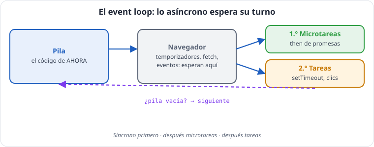
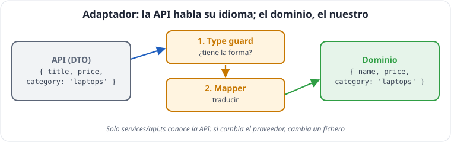
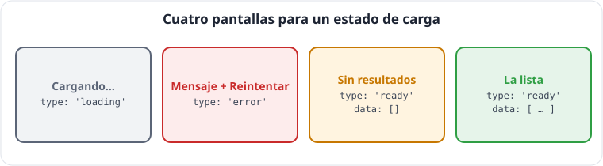

# Unidad 7 · Asincronía y datos de internet

*Apuntes de **Isaías FL** · Desarrollo Web en Entorno Cliente · 2.º DAW · Curso 2026‑27*

> **Qué vas a aprender:** por qué JavaScript puede esperar sin congelar la página, qué es una **promesa**, cómo escribir código que espera con `async`/`await`, cómo pedir datos a internet con `fetch` **sin caer en sus dos trampas**, y cómo enseñar en pantalla «cargando», «error» o «sin resultados».
> **API de prácticas:** [dummyjson.com](https://dummyjson.com/docs). Es pública, gratuita y no pide registro.

---

## Índice

1. [El problema: esperar sin congelar la página](#1-el-problema-esperar-sin-congelar-la-página)
2. [El orden real: el event loop](#2-el-orden-real-el-event-loop)
3. [Promesas: el ticket del pedido](#3-promesas-el-ticket-del-pedido)
4. [`async` / `await`: esperar escribiendo normal](#4-async--await-esperar-escribiendo-normal)
5. [Varias esperas a la vez](#5-varias-esperas-a-la-vez)
6. [`fetch`: pedir datos a internet](#6-fetch-pedir-datos-a-internet)
7. [El adaptador: traducir lo que manda la API](#7-el-adaptador-traducir-lo-que-manda-la-api)
8. [Estados de carga en pantalla](#8-estados-de-carga-en-pantalla)
9. [Buscadores: cancelar y no pedir de más](#9-buscadores-cancelar-y-no-pedir-de-más)
10. [Errores con significado](#10-errores-con-significado)
11. [Fichas técnicas](#11-fichas-técnicas)
12. [Autoevaluación](#12-autoevaluación)

---

## 1. El problema: esperar sin congelar la página

Pedir datos a un servidor tarda: medio segundo, dos, a veces más. JavaScript hace **una sola cosa a la vez**. Si se quedara parado esperando, la página se **congelaría**: no podrías hacer scroll, ni pulsar botones, ni escribir.

> **Analogía de la pizzería.** Pides una pizza por teléfono.
> - **Síncrono** sería quedarte con el teléfono en la oreja 30 minutos, sin hacer nada más, hasta que llegue.
> - **Asíncrono** es colgar, seguir con tu vida, y **cuando llaman al timbre**, abrir.

Asíncrono **no** significa hacer dos cosas a la vez. Significa **no quedarse esperando**.

`setTimeout` es la forma más sencilla de verlo: «ejecuta esto dentro de un rato».

```ts
console.log('1. Llamo a la pizzería');

setTimeout(() => {
  console.log('3. ¡Ding dong! Llega la pizza');
}, 2000);   // dentro de 2000 ms = 2 segundos

console.log('2. Mientras tanto, pongo la mesa');
```

Salida:

```
1. Llamo a la pizzería
2. Mientras tanto, pongo la mesa
3. ¡Ding dong! Llega la pizza       ← dos segundos después
```

El código **no se para** en el `setTimeout`. Apunta «dentro de 2 s, haz esto» y sigue.

---

## 2. El orden real: el event loop

**El problema:** ¿en qué orden salen estos mensajes?

```ts
console.log('A');
setTimeout(() => console.log('B'), 0);   // ¡0 milisegundos!
console.log('C');
```

Muchos dicen `A B C`. Sale **`A C B`**. Aunque el tiempo sea 0, `B` espera.

**Qué es:** el **event loop** («bucle de eventos») es el encargado de decidir qué se ejecuta y cuándo. Funciona así:

1. Primero se ejecuta **todo el código normal**, de arriba abajo (`A` y `C`).
2. Lo que tiene que esperar (temporizadores, respuestas del servidor, clics) **se queda en una cola**.
3. Cuando el código normal termina, el event loop saca cosas de la cola **una a una** (`B`).



> **Tres reglas para recordar:**
> 1. Lo normal (síncrono) **siempre** termina antes que cualquier cosa que espera.
> 2. `setTimeout(f, 0)` no significa «ahora»: significa «en cuanto estés libre».
> 3. Las promesas (apartado 3) tienen **preferencia** sobre los `setTimeout`.

```ts
console.log('1. normal');
setTimeout(() => console.log('4. setTimeout'), 0);
Promise.resolve().then(() => console.log('3. promesa'));   // se cuela antes
console.log('2. normal');
```

---

## 3. Promesas: el ticket del pedido

**El problema:** con `setTimeout` dentro de `setTimeout` dentro de `setTimeout`, el código se vuelve una escalera ilegible. Hace falta algo para decir «cuando esto termine, haz aquello» de forma ordenada.

**Qué es:** una **promesa** es un objeto que representa un valor **que todavía no tienes, pero tendrás**. Como el **ticket** que te dan al pedir en la hamburguesería: aún no tienes la hamburguesa, pero el ticket te asegura que te avisarán.

Una promesa está siempre en uno de **tres estados**:

| Estado | Hamburguesería | Promesa |
|---|---|---|
| **Pendiente** | están cocinando | todavía no hay resultado |
| **Cumplida** | te dan tu hamburguesa | hay un **valor** |
| **Rechazada** | «se nos ha acabado el pan» | hay un **error** |

### Usar una promesa: `then`, `catch` y `finally`

Casi nunca crearás promesas: te las darán funciones como `fetch`. Lo que harás es **usarlas**. Para practicar, tenemos una función que finge preguntar el tiempo a un servidor:

```ts
// Finge una petición: tarda 'ms' milisegundos y entrega 'data' (o falla si fail es true)
function fakeRequest<T>(data: T, ms: number, fail = false): Promise<T> {
  return new Promise((resolve, reject) => {
    setTimeout(() => {
      if (fail) reject(new Error('El servidor no responde'));
      else resolve(data);
    }, ms);
  });
}
```

No hace falta entenderla por dentro todavía. Lo importante es lo que devuelve: `Promise<T>`, «una promesa que **entregará** un `T`». `Promise<number>` entregará un número; `Promise<string[]>`, una lista de textos.

```ts
fakeRequest(21, 1000)                                    // Promise<number>
  .then((degrees) => console.log(`Hace ${degrees} °C`))  // si se cumple: el valor
  .catch((error: unknown) => console.log('Fallo:', error)) // si se rechaza: el error
  .finally(() => console.log('Quitar el «Cargando…»'));  // en los dos casos
```

- **`then`**: «cuando tengas el valor, haz esto con él».
- **`catch`**: «si falla, haz esto».
- **`finally`**: «pase lo que pase, al final haz esto». Ideal para quitar un «Cargando…».

Cambia el `1000` por `1000, true` y verás el camino del error.

> **Ojo:** en `catch`, anota el error como `error: unknown`. Puede ser cualquier cosa, y así TypeScript te obliga a comprobarlo antes de usarlo.

### Encadenar

Lo que devuelve un `then` le llega al siguiente:

```ts
fakeRequest(['madrid', 'granada'], 500)
  .then((cities) => cities.map((c) => c.toUpperCase()))   // devuelve un array
  .then((upper) => console.log(upper));                   // lo recibe: ['MADRID', 'GRANADA']
```

### Crear una promesa (para entenderlas)

La función más útil que puedes crear tú es «esperar un rato»:

```ts
function wait(ms: number): Promise<void> {
  return new Promise((resolve) => setTimeout(resolve, ms));
}

wait(1500).then(() => console.log('Ha pasado segundo y medio'));
```

`new Promise` recibe una función con dos «botones»: **`resolve`** (cumplir) y **`reject`** (rechazar). Llamas a uno de los dos cuando termina la espera. `Promise<void>` significa «avisa cuando acabe, pero no entrega ningún valor».

---

## 4. `async` / `await`: esperar escribiendo normal

**El problema:** las cadenas de `then` funcionan, pero cuando hay que esperar varias cosas seguidas cuesta leerlas.

**Qué es:** `async`/`await` es **otra forma de escribir lo mismo**: el código se lee de arriba abajo, como si no hubiera esperas.

**El mismo ejemplo del tiempo, con `await`:**

```ts
async function showWeather(): Promise<void> {
  try {
    const degrees = await fakeRequest(21, 1000);   // espera aquí y dame el valor
    console.log(`Hace ${degrees} °C`);
  } catch (error) {
    console.log('Fallo:', error instanceof Error ? error.message : error);
  } finally {
    console.log('Quitar el «Cargando…»');
  }
}

void showWeather();
```

Compara con el apartado 3: `then` pasa a ser `await`, y `catch` pasa a ser `try/catch`. **Es exactamente lo mismo**, escrito de otra manera.

Cinco reglas:

1. **`await promesa`** significa: «espera aquí y dame su valor».
2. `await` solo se puede usar **dentro de una función `async`**.
3. Una función `async` **siempre devuelve una promesa**. Si haces `return 5`, devuelve `Promise<number>`.
4. `await` **pausa esa función**, no la página. El resto sigue respondiendo.
5. Los errores se capturan con **`try/catch`**.

**Varias esperas seguidas**, que es donde `await` brilla. Por ejemplo, un juego que carga el perfil y luego las partidas:

```ts
interface Profile { nick: string }

async function loadPlayer(): Promise<string> {
  const profile = await fakeRequest<Profile>({ nick: 'lucia_23' }, 500);
  const scores = await fakeRequest([120, 340, 90], 500);
  const best = Math.max(...scores);
  return `${profile.nick}: mejor partida ${best} puntos`;
}

loadPlayer().then(console.log);   // lucia_23: mejor partida 340 puntos
```

> **`void` delante de una llamada** (`void showWeather()`) le dice a TypeScript: «sé que devuelve una promesa y no voy a esperarla aquí». Es una forma de ser explícito.

---

## 5. Varias esperas a la vez

**El problema:** el programa del ejemplo anterior tarda **1 segundo** (500 + 500), porque espera el perfil y **después** las partidas. Pero las partidas no necesitan el perfil: se podrían pedir **a la vez**.

**Qué es:** **`Promise.all`** lanza varias promesas a la vez y espera a que terminen **todas**.

```ts
async function loadHome(): Promise<void> {
  const [weather, news] = await Promise.all([
    fakeRequest('Soleado, 21 °C', 800),
    fakeRequest(['Abre la biblioteca', 'Partido el sábado'], 500),
  ]);
  console.log(weather, news);   // tarda 800 ms (la más lenta), no 1300
}
void loadHome();
```

El resultado es un array **en el mismo orden** en que las pediste. Por eso se desestructura: `[weather, news]`.

**Pero si falla una, falla todo.** Si la portada puede vivir sin las noticias, usa **`Promise.allSettled`**: espera a todas y te dice cuál fue bien y cuál mal.

```ts
async function loadHomeSafe(): Promise<void> {
  const results = await Promise.allSettled([
    fakeRequest('Soleado, 21 °C', 300),
    fakeRequest(['noticia'], 300, true),     // esta falla
  ]);
  for (const r of results) {
    console.log(r.status === 'fulfilled' ? r.value : 'No disponible');
  }
}
void loadHomeSafe();
```

| Si necesitas... | Usa |
|---|---|
| todo, y si falla algo no sirve nada | `Promise.all` |
| todo lo que se pueda; lo que falle, se avisa | `Promise.allSettled` |

> [!WARNING]
> **Error típico:** `await` dentro de un `for` hace las peticiones **una detrás de otra**. Si no dependen entre sí, junta las promesas y usa `Promise.all`.

---

## 6. `fetch`: pedir datos a internet

**El problema:** hasta ahora hemos fingido las peticiones. Los datos de verdad (el tiempo, noticias, usuarios, productos) están en **servidores**.

**Qué es:** **`fetch`** es la función del navegador para pedir algo a una URL. Devuelve una **promesa** con la **respuesta** del servidor.

**El ejemplo: una frase célebre al azar.**

```ts
async function randomQuote(): Promise<void> {
  const response = await fetch('https://dummyjson.com/quotes/random');  // 1. pedir
  const data: unknown = await response.json();                          // 2. leer el cuerpo
  console.log(data);
  // { id: 12, quote: 'La vida es...', author: '...' }
}
void randomQuote();
```

**Dos `await`, no uno.** El primero espera a que el servidor **conteste** (sabemos si fue bien o mal). El segundo espera a que llegue **todo el contenido** y lo convierte de JSON a objeto.

Hasta aquí parece fácil. Pero `fetch` tiene **dos trampas** en las que cae todo el mundo.

### Trampa 1: un 404 no es un error para `fetch`

```ts
async function missingQuote(): Promise<void> {
  const response = await fetch('https://dummyjson.com/quotes/99999');   // no existe
  console.log(response.ok, response.status);   // false 404
  // ¡No ha saltado ningún error! fetch considera que "el servidor ha contestado"
}
void missingQuote();
```

`fetch` **solo falla** si no hay respuesta: sin internet, la dirección no existe... Si el servidor contesta «no encontrado» (404) o «me he roto» (500), para `fetch` **ha ido bien**.

| Qué pasa | ¿`fetch` lanza error? | `response.ok` |
|---|---|---|
| Todo bien (200) | no | `true` |
| No encontrado (404) o fallo del servidor (500) | **no** | `false` |
| Sin internet o dirección imposible | **sí** | — |

> **Solución:** mira **siempre** `response.ok` y lanza tú el error.

### Trampa 2: `response.json()` no comprueba nada

`response.json()` devuelve `any`: TypeScript te deja hacer lo que quieras con él, **incluso equivocarte**.

```ts
// (fragmento, dentro de una función async)
const raw = await response.json();      // any
console.log(raw.qoute);                 // errata: compila igual y sale undefined
```

> **Solución:** guárdalo como **`unknown`** («no sé qué es») y compruébalo, igual que hicimos con `localStorage` en la U6. *Lo que viene de fuera es `unknown` hasta que se demuestre lo contrario.*

### La función que usaremos siempre

Las dos soluciones juntas, en una función reutilizable:

```ts
async function getJson(url: string): Promise<unknown> {
  const response = await fetch(url);
  if (!response.ok) {
    throw new Error(`Error HTTP ${response.status}`);   // trampa 1
  }
  const data: unknown = await response.json();          // trampa 2
  return data;
}
```

### URLs con parámetros

Cuando la URL lleva lo que escribe el usuario (una búsqueda), **no la montes a mano**: `URL` codifica los espacios, tildes y símbolos por ti.

```ts
const url = new URL('https://dummyjson.com/users/search');
url.searchParams.set('q', 'José María');
console.log(url.href);   // https://dummyjson.com/users/search?q=Jos%C3%A9+Mar%C3%ADa
```

### Enviar datos (POST)

Para **mandar** algo al servidor (un comentario, una inscripción), se añade un segundo argumento:

```ts
async function sendComment(text: string): Promise<unknown> {
  const response = await fetch('https://dummyjson.com/comments/add', {
    method: 'POST',                                     // mandar, no pedir
    headers: { 'Content-Type': 'application/json' },    // "te mando JSON"
    body: JSON.stringify({ body: text, postId: 1, userId: 1 }),
  });
  if (!response.ok) throw new Error(`Error HTTP ${response.status}`);
  return response.json();
}
void sendComment('Muy buen artículo');
```

---

## 7. El adaptador: traducir lo que manda la API

**El problema:** la API de usuarios manda los datos **a su manera**: `firstName`, `lastName`, `email`, y otros 20 campos que no necesitas. Si usas ese formato por toda tu aplicación, el día que cambie la API tendrás que tocar **todos** los archivos.

**Qué es:**

- **DTO** (*Data Transfer Object*): la forma en que **la API** manda los datos.
- **Adaptador**: el código que **comprueba** el DTO y lo **traduce** a tu tipo.

```
   INTERNET (DTO)                 services/users.ts (ADAPTADOR)          TU APP
 { firstName: 'Emily',    ──▶   1. ¿tiene la forma? (type guard)  ──▶  { name: 'Emily Johnson',
   lastName: 'Johnson',         2. traducir                            email: '...' }
   email: '...', ...20 más }
```



```ts
// Lo que usa TU aplicación
export interface Contact {
  id: number;
  name: string;
  email: string;
}

// Lo que manda la API (solo lo que nos interesa). NO se exporta: es un detalle interno.
interface ApiUser {
  id: number;
  firstName: string;
  lastName: string;
  email: string;
}

// 1. Comprobar la forma
function isApiUser(raw: unknown): raw is ApiUser {
  return (
    typeof raw === 'object' && raw !== null &&
    'id' in raw && typeof raw.id === 'number' &&
    'firstName' in raw && typeof raw.firstName === 'string' &&
    'lastName' in raw && typeof raw.lastName === 'string' &&
    'email' in raw && typeof raw.email === 'string'
  );
}

// 2. Traducir
function toContact(user: ApiUser): Contact {
  return { id: user.id, name: `${user.firstName} ${user.lastName}`, email: user.email };
}

// Todo junto: pedir, comprobar, traducir
export async function loadContacts(): Promise<Contact[]> {
  const data = await getJson('https://dummyjson.com/users?limit=10&select=id,firstName,lastName,email');
  if (typeof data !== 'object' || data === null || !('users' in data)) {
    throw new Error('Respuesta inesperada');
  }
  const { users } = data;
  if (!Array.isArray(users) || !users.every(isApiUser)) {
    throw new Error('Respuesta inesperada');
  }
  return users.map(toContact);
}
```

El resto de la aplicación solo ve `Contact`. Si mañana cambias de proveedor de usuarios, **solo cambia este archivo**. Son las capas de la U4: este archivo es un **servicio**.

---

## 8. Estados de carga en pantalla

**El problema:** mientras llegan los datos, ¿qué ve el usuario? ¿Y si falla? ¿Y si no hay resultados? Una pantalla en blanco no dice nada.

**Qué es:** el estado de una carga es una **unión discriminada** (U4) con un caso por cada situación:

```ts
type LoadState<T> =
  | { status: 'loading' }
  | { status: 'error'; message: string }
  | { status: 'ready'; data: T };
```

Y la vista elige qué enseñar con un `switch`:

```ts
function contactsMessage(state: LoadState<Contact[]>): string {
  switch (state.status) {
    case 'loading':
      return 'Cargando contactos…';
    case 'error':
      return `No se han podido cargar: ${state.message}`;   // y un botón «Reintentar»
    case 'ready':
      return state.data.length === 0
        ? 'No tienes contactos todavía'
        : `${state.data.length} contactos`;
  }
}
```



> [!IMPORTANT]
> **Clave:** son **cuatro pantallas**, no tres: cargando, error, **lista vacía** y lista con datos. «No hay resultados» **no es un error**: la petición fue bien.

---

## 9. Buscadores: cancelar y no pedir de más

Un buscador que pide resultados **mientras escribes** tiene dos problemas.

### Problema 1: una petición por cada tecla

Si el usuario escribe `maria`, se lanzan 5 peticiones: `m`, `ma`, `mar`, `mari`, `maria`. Solo interesa la última.

**Solución: debounce.** «Espera a que deje de escribir un momento, y entonces busca». Cada tecla **reinicia** una cuenta atrás. Es una **fábrica con closure** (sesión 08): `timer` vive en la mochila.

```ts
function debounce(fn: (text: string) => void, ms: number): (text: string) => void {
  let timer: ReturnType<typeof setTimeout> | undefined;
  return (text) => {
    clearTimeout(timer);                      // cancela la cuenta atrás anterior
    timer = setTimeout(() => fn(text), ms);   // y empieza una nueva
  };
}

const searchLater = debounce((text) => console.log('Buscar:', text), 400);
['m', 'ma', 'mar', 'mari', 'maria'].forEach((t) => searchLater(t));
// Solo sale: Buscar: maria
```

### Problema 2: una respuesta vieja pisa a la nueva

```
t=0    busco "mar"    ──────────────────────────▶ llega en t=900
t=500  busco "maria"  ─────────▶ llega en t=700 → pantalla: maria (bien)
t=900                                              pantalla: mar   (¡mal!)
```

**Solución: cancelar la anterior con `AbortController`**, un «mando a distancia» para detener una petición.

```ts
let current: AbortController | null = null;

async function searchUsers(text: string): Promise<void> {
  current?.abort();                     // si había una búsqueda en marcha, se cancela
  const controller = new AbortController();
  current = controller;

  try {
    const url = new URL('https://dummyjson.com/users/search');
    url.searchParams.set('q', text);
    const response = await fetch(url, { signal: controller.signal });   // el mando, conectado
    console.log(text, response.status);
  } catch (error) {
    if (controller.signal.aborted) return;   // la hemos cancelado nosotros: no es un error
    console.log('Error real:', error);
  }
}
```

> **Resumen:** el **debounce** evita peticiones inútiles; el **`AbortController`** evita que una respuesta vieja pise a una nueva. Un buscador bueno usa los dos.

---

## 10. Errores con significado

**El problema:** al usuario no le sirve ver `Error HTTP 503`. Le sirve «El servidor tiene problemas, inténtalo más tarde».

**Qué hacemos:** una clase de error propia que guarda el código HTTP, y una función que traduce cada error a un mensaje humano.

```ts
class HttpError extends Error {
  readonly status: number;
  constructor(status: number) {
    super(`El servidor respondió ${status}`);
    this.name = 'HttpError';
    this.status = status;
  }
}

function friendlyMessage(error: unknown): string {
  if (error instanceof HttpError) {
    if (error.status === 404) return 'No se ha encontrado lo que buscas';
    if (error.status >= 500) return 'El servidor tiene problemas. Inténtalo más tarde';
    return `Error del servidor (${error.status})`;
  }
  if (error instanceof TypeError) return 'No hay conexión a internet';
  if (error instanceof Error) return error.message;
  return 'Error desconocido';
}

console.log(friendlyMessage(new HttpError(404)));          // No se ha encontrado lo que buscas
console.log(friendlyMessage(new TypeError('fetch failed'))); // No hay conexión a internet
```

En `getJson` bastaría con cambiar `throw new Error(...)` por `throw new HttpError(response.status)`.

Los `if` van **del más concreto al más general**: si `Error` fuera el primero, se tragaría todos los demás.

---

## 11. Fichas técnicas

*Para consultar, no para memorizar.*

**Promesas**

| Miembro | Qué hace |
|---|---|
| `new Promise<T>((resolve, reject) => { ... })` | crea una promesa; la función se ejecuta **en el momento** |
| `promesa.then(fn)` | cuando se cumpla, ejecuta `fn(valor)`; devuelve una promesa nueva |
| `promesa.catch(fn)` | si se rechaza, ejecuta `fn(error)`; anota `error: unknown` |
| `promesa.finally(fn)` | siempre, al terminar; `fn` no recibe nada |
| `Promise.resolve(v)` / `Promise.reject(e)` | promesa ya cumplida / ya rechazada |

**Combinar promesas**

| Método | Espera a | Si una falla | Uso |
|---|---|---|---|
| `Promise.all` | todas | falla todo | varias cosas imprescindibles |
| `Promise.allSettled` | todas | sigue y te dice cuál | varias cosas opcionales |
| `Promise.race` | la primera en **terminar** | depende de la primera | tiempo límite |
| `Promise.any` | la primera en **cumplirse** | ignora las que fallan | varios servidores alternativos |

**Temporizadores**

| Función | Qué hace |
|---|---|
| `setTimeout(fn, ms)` | ejecuta `fn` **como pronto** pasados `ms`; devuelve un identificador |
| `clearTimeout(id)` | cancela ese `setTimeout` |
| `setInterval(fn, ms)` / `clearInterval(id)` | igual, pero se repite cada `ms` |

**`fetch` y `Response`**

| Miembro | Qué es | Ojo |
|---|---|---|
| `fetch(url, opciones?)` | `Promise<Response>` | solo falla si **no hay respuesta**; un 404 no es error |
| opciones | `method`, `headers`, `body`, `signal` | `body` con `JSON.stringify` |
| `response.ok` | `true` si el código está entre 200 y 299 | compruébalo **siempre** |
| `response.status` | el código: 200, 404, 500... | |
| `response.json()` | `Promise<any>` | guárdalo como `unknown` |
| `response.text()` | `Promise<string>` | |
| el cuerpo | se lee **una sola vez** | leerlo dos veces da error |

**Códigos HTTP más comunes**

| Código | Significa |
|---|---|
| 200 | bien |
| 201 | creado (tras un POST) |
| 400 | la petición está mal hecha |
| 401 / 403 | no has iniciado sesión / no tienes permiso |
| 404 | no existe |
| 500 / 503 | el servidor ha fallado / no está disponible |

**`AbortController`**

| Miembro | Qué hace |
|---|---|
| `new AbortController()` | crea el «mando» |
| `controller.signal` | se pasa a `fetch` en `{ signal }` |
| `controller.abort()` | cancela: el `fetch` falla con un error `AbortError` |
| `controller.signal.aborted` | `true` si ya se canceló |
| `AbortSignal.timeout(ms)` | una señal que se cancela sola pasados `ms` (tiempo límite) |

---

## 12. Autoevaluación

- [ ] Explica con la pizzería la diferencia entre síncrono y asíncrono.
- [ ] ¿En qué orden salen `console.log('A')`, `setTimeout(() => console.log('B'), 0)` y `console.log('C')`? ¿Por qué?
- [ ] ¿Cuáles son los tres estados de una promesa?
- [ ] ¿Qué significa `Promise<string>`?
- [ ] ¿Qué devuelve una función `async` que hace `return 5`?
- [ ] Reescribe un `.then().catch()` con `async`/`await`.
- [ ] Tienes que cargar el tiempo y las noticias, que no dependen entre sí. ¿Cómo lo haces para que tarde menos?
- [ ] ¿`fetch` lanza un error si el servidor responde 404? ¿Qué hay que hacer?
- [ ] ¿Por qué guardamos `response.json()` como `unknown`?
- [ ] ¿Qué es un DTO y por qué no se exporta?
- [ ] ¿Por qué «sin resultados» no es un estado de error?
- [ ] ¿Qué problema resuelve el debounce? ¿Y el `AbortController`?
