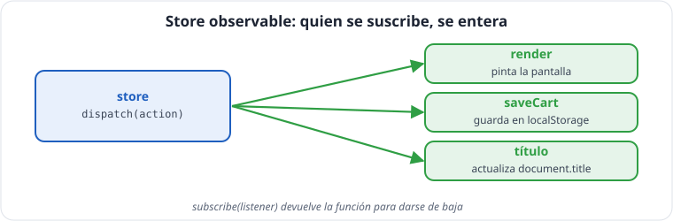
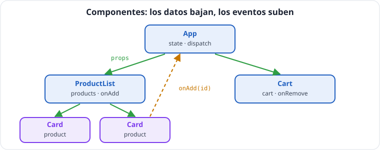

# Unidad 8 · Patrones profesionales y puente a React

*Apuntes de **Isaías FL** · Desarrollo Web en Entorno Cliente · 2.º DAW · Curso 2026‑27*

> **Qué vas a aprender:** a avisar a varias partes de la app cuando cambia el estado (**store observable**), las **clases** justas que necesitas, el nombre de los **patrones** que ya has usado sin saberlo, a construir **componentes** a mano y, al final, cómo todo eso se convierte en **React**.
> **La idea de la unidad:** React no es magia. Es lo que ya sabes hacer (estado, reductor, componentes, efectos) con el trabajo pesado hecho por ti.

---

## Índice

1. [El store observable: avisar a todos](#1-el-store-observable-avisar-a-todos)
2. [Clases, lo justo](#2-clases-lo-justo)
3. [Los patrones que ya usas](#3-los-patrones-que-ya-usas)
4. [Componentes: funciones que devuelven pantalla](#4-componentes-funciones-que-devuelven-pantalla)
5. [De `createElement` a JSX](#5-de-createelement-a-jsx)
6. [El primer proyecto React](#6-el-primer-proyecto-react)
7. [JSX: las seis reglas](#7-jsx-las-seis-reglas)
8. [Estado en React: `useState` y `useReducer`](#8-estado-en-react-usestate-y-usereducer)
9. [Efectos: `useEffect`](#9-efectos-useeffect)
10. [Tabla de traducción: de octubre a React](#10-tabla-de-traducción-de-octubre-a-react)
11. [Fichas técnicas](#11-fichas-técnicas)
12. [Autoevaluación](#12-autoevaluación)

---

## 1. El store observable: avisar a todos

**El problema:** en una app de música, cuando el usuario pulsa «me gusta» en una canción hay que hacer **tres cosas**: actualizar el corazón, actualizar el contador de la cabecera y guardar en `localStorage`. Si `dispatch` hace las tres a mano, cada cosa nueva obliga a tocar `dispatch`.

**Qué es:** un **store** guarda el estado y, cuando cambia, **avisa a todos los que se han apuntado**. Como un **grupo de WhatsApp**: el que escribe no avisa a cada persona; escribe en el grupo y le llega a todos los que están dentro.

- **Suscribirse** = entrar en el grupo.
- **Dispatch** = escribir en el grupo.
- **Darse de baja** = salir del grupo.



**El ejemplo:** primero, un reductor sencillo para los «me gusta» (U5):

```ts
type LikesAction = { type: 'like' } | { type: 'reset' };

function likesReducer(count: number, action: LikesAction): number {
  switch (action.type) {
    case 'like':
      return count + 1;
    case 'reset':
      return 0;
  }
}
```

Y la fábrica del store. Es una **fábrica con closure** (sesión 08): `state` y `listeners` viven en la mochila.

```ts
type Listener<S> = (state: S) => void;

function createStore<S, A>(reducer: (state: S, action: A) => S, initial: S) {
  let state = initial;                           // el dato, escondido en la mochila
  const listeners = new Set<Listener<S>>();      // la lista del grupo

  return {
    getState: () => state,

    dispatch: (action: A): void => {
      state = reducer(state, action);
      listeners.forEach((listener) => listener(state));   // avisar a todos
    },

    subscribe: (listener: Listener<S>): (() => void) => {
      listeners.add(listener);
      return () => listeners.delete(listener);   // devuelve la forma de darse de baja
    },
  };
}
```

**Usarlo:**

```ts
const likes = createStore(likesReducer, 0);

const leave = likes.subscribe((n) => console.log(`Corazón: ${n}`));
likes.subscribe((n) => console.log(`Guardar ${n} en localStorage`));

likes.dispatch({ type: 'like' });
// Corazón: 1
// Guardar 1 en localStorage

leave();                              // el corazón sale del grupo
likes.dispatch({ type: 'like' });
// Guardar 2 en localStorage
```

**¿Qué hemos ganado?** Para añadir una cuarta cosa (por ejemplo, un sonido), haces otro `subscribe`. **No tocas `dispatch` ni el reductor.**

- `<S, A>` son **genéricos** (U4): `S` es el tipo del estado y `A` el de las acciones. El mismo `createStore` sirve para «me gusta», para una lista de tareas o para un juego.

> [!NOTE]
> **En la empresa:** este patrón se llama **Observer**. `addEventListener` es Observer. **Redux** y **Zustand** son este mismo store en versión profesional. Y en React, un componente «se suscribe» a su estado y se repinta cuando cambia.

---

## 2. Clases, lo justo

**El problema:** a veces quieres un objeto que **guarde datos y tenga sus propias reglas**. Por ejemplo, una hucha: puedes meter dinero, pero nunca más de 500 €, y nadie puede cambiar el saldo a mano.

**Qué es:** una **clase** es un **molde** para fabricar objetos que tienen datos y métodos. Con `new` sacas un objeto del molde.

> En React moderno casi no se usan clases: se usan funciones. Pero aparecen en librerías, en Angular, en Java y, sobre todo, para crear **errores propios**. Por eso hay que saber leerlas.

```ts
class PiggyBank {
  #balance = 0;                       // # = privado: nadie de fuera puede tocarlo
  readonly owner: string;             // se pone al crearla y no cambia
  static readonly MAX = 500;          // es de la CLASE, igual para todas las huchas

  constructor(owner: string) {        // se ejecuta al hacer new
    this.owner = owner;
  }

  get balance(): number {             // getter: se lee como una propiedad, sin ()
    return this.#balance;
  }

  deposit(amount: number): void {
    if (amount <= 0 || this.#balance + amount > PiggyBank.MAX) {
      throw new RangeError('Cantidad no válida');
    }
    this.#balance += amount;
  }
}

const martaBank = new PiggyBank('Marta');
martaBank.deposit(20);
martaBank.deposit(15);
console.log(martaBank.owner, martaBank.balance);   // Marta 35
// martaBank.#balance = 1000;   ← error: es privado
```

| Palabra | Qué significa |
|---|---|
| `class PiggyBank` | el molde |
| `new PiggyBank('Marta')` | fabrica un objeto (una **instancia**) |
| `constructor(...)` | lo que se ejecuta al fabricarlo |
| `this` | «este objeto en concreto» |
| `#balance` | privado **de verdad**: inaccesible incluso en ejecución |
| `get balance()` | se lee como propiedad: `martaBank.balance` |
| `static` | pertenece a la clase, no a cada objeto: `PiggyBank.MAX` |

**¿Te suena?** Es lo mismo que `makeLives` de la sesión 08: un dato escondido y funciones que lo cambian con reglas. Una clase y una fábrica con closure resuelven el mismo problema.

> **Ojo:** la forma corta `constructor(private owner: string) {}` que verás en internet **no compila** en los proyectos Vite actuales. Declara el campo y asígnalo dentro del constructor, como arriba.

### El caso donde sí se usa herencia: errores propios

`extends` significa «esta clase es como aquella, pero con algo más». Un `ValidationError` es un `Error` que además sabe **qué campo** falló:

```ts
class ValidationError extends Error {
  readonly field: string;

  constructor(field: string, message: string) {
    super(message);                 // primero, construir la parte de Error
    this.name = 'ValidationError';
    this.field = field;
  }
}

try {
  throw new ValidationError('age', 'debe estar entre 8 y 99');
} catch (error) {
  if (error instanceof ValidationError) {
    console.log(`Error en ${error.field}: ${error.message}`);   // Error en age: debe estar entre 8 y 99
  }
}
```

Ya hiciste uno en la U7: `HttpError`.

---

## 3. Los patrones que ya usas

**Ya los has usado todos.** Aquí tienen su nombre profesional, el que oirás en una entrevista o en una empresa:

| Patrón | En una frase | Dónde lo usaste |
|---|---|---|
| **Función pura** | misma entrada, mismo resultado, sin efectos | todo el dominio (`average`, `validateSignup`) |
| **Inmutabilidad** | no se modifica: se crea una copia | `toSorted`, el reductor |
| **Capas** | cada cosa en su carpeta; el dominio no sabe de pantallas | `types/`, `utils/`, `services/`, `components/` |
| **Factory** (fábrica) | una función que crea cosas ya configuradas | `makeMinChecker`, `makeCounter`, `createStore` |
| **Closure** | función con mochila de datos privados | `makeCounter`, `debounce` |
| **Adapter** (adaptador) | traduce el formato de otro al tuyo | `toContact` (U7) |
| **Service** (servicio) | oculta de dónde vienen los datos | `loadContacts`, `loadTasks` |
| **Observer** | los interesados se apuntan y les avisan | `addEventListener`, `subscribe` |
| **Reducer** | `(estado, acción) → estado nuevo` | `likesReducer` |
| **Única fuente de verdad** | cada dato vive en un solo sitio | estado → render (U5) |
| **Validar en la frontera** | lo de fuera es `unknown` hasta comprobarlo | formularios, `localStorage`, API |

**SOLID**, una línea cada uno (también sale en entrevistas):

- **S**: cada módulo hace **una** cosa. *(`utils/grades.ts` calcula; no pinta.)*
- **O**: añadir sin romper lo que funciona. *(Un suscriptor nuevo no toca `dispatch`.)*
- **L**: un hijo sirve donde se espera el padre. *(`HttpError` vale donde se espera un `Error`.)*
- **I**: interfaces pequeñas. *(Cada componente pide solo las props que usa.)*
- **D**: el núcleo no depende de los detalles. *(`utils/` no importa nada de `services/`.)*

---

## 4. Componentes: funciones que devuelven pantalla

**El problema:** en la app de música, cada canción se ve igual: título, artista y un botón de «me gusta». Escribir el `createElement` de cada una a mano es repetir lo mismo veinte veces.

**Qué es:** un **componente** es una función que recibe un objeto con datos (las **props**) y **devuelve un trozo de pantalla**. Como un **molde de galletas**: el mismo molde, distinta masa.

```ts
interface Song {
  id: number;
  title: string;
  artist: string;
}

interface SongCardProps {
  song: Song;
  onLike: (id: number) => void;     // una función: «avisa cuando le den a me gusta»
}

function SongCard({ song, onLike }: SongCardProps): HTMLElement {
  const li = document.createElement('li');

  const text = document.createElement('span');
  text.textContent = `${song.title} · ${song.artist}`;

  const button = document.createElement('button');
  button.textContent = 'Me gusta';
  button.addEventListener('click', () => onLike(song.id));

  li.append(text, button);
  return li;
}
```

Y un componente puede **usar otros componentes**. Una lista es muchas tarjetas:

```ts
function SongList({ songs, onLike }: { songs: readonly Song[]; onLike: (id: number) => void }): HTMLElement {
  const ul = document.createElement('ul');
  ul.append(...songs.map((song) => SongCard({ song, onLike })));
  return ul;
}

const songs: Song[] = [
  { id: 1, title: 'Bohemian Rhapsody', artist: 'Queen' },
  { id: 2, title: 'Mediterráneo', artist: 'Serrat' },
];

const list = SongList({ songs, onLike: (id) => console.log('Me gusta la canción', id) });
document.body.append(list);
```



> **La regla de oro de los componentes:** *los datos **bajan** por props; los avisos **suben** por funciones.*
> `SongCard` no sabe qué es un «me gusta» ni dónde se guarda. Solo avisa: «me han pulsado, y soy la canción 2». Quien la usa decide qué hacer.

```
             App            ← tiene el estado
              │ songs, onLike (bajan)
          SongList
              │ song, onLike (bajan)
         SongCard × N       → onLike(id) (sube)
```

---

## 5. De `createElement` a JSX

**El problema:** el componente `SongCard` tiene 10 líneas para algo que en HTML serían 4.

**El paso intermedio:** una función auxiliar `h` (de *hyperscript*) que crea un elemento con sus hijos en una sola llamada:

```ts
function h(tag: string, props: { onClick?: () => void } = {}, ...children: (Node | string)[]): HTMLElement {
  const el = document.createElement(tag);
  if (props.onClick) el.addEventListener('click', props.onClick);
  el.append(...children);              // los textos entran como texto: seguro ante XSS
  return el;
}

const card = h('li', {},
  h('span', {}, 'Mediterráneo · Serrat'),
  h('button', { onClick: () => console.log('me gusta') }, 'Me gusta'),
);
```

Ya se parece mucho más al HTML. Pues **JSX** es exactamente esto, escrito con etiquetas:

```tsx
<li>
  <span>Mediterráneo · Serrat</span>
  <button onClick={() => console.log('me gusta')}>Me gusta</button>
</li>
```

> **JSX no es HTML.** Es una forma cómoda de escribir llamadas a una función como `h`. Al compilar, cada etiqueta se convierte en una llamada. Por eso los eventos reciben **funciones** y se escribe `className` en vez de `class`.

### Lo que React añade de verdad

En la U5 hacíamos `render()`: borrar la pantalla entera y volver a pintarla. Funciona, pero tiene un problema: si estabas escribiendo en un `<input>`, ese input se borra, se crea otro nuevo y **pierdes el foco y el cursor**.

React también «vuelve a pintar todo», pero **en memoria**. Luego **compara** con lo que había y **solo toca en la página lo que ha cambiado**. Eso se llama **reconciliación**, y es la gran aportación de React.

---

## 6. El primer proyecto React

```bash
npm create vite@latest music-app -- --template react-ts
cd music-app
npm install
npm run dev
```

```
music-app/
├── index.html          ← tiene un <div id="root"></div>
├── vite.config.ts      ← activa React
└── src/
    ├── main.tsx        ← arranca React dentro de #root
    └── App.tsx         ← el componente principal
```

- **`.tsx`** = TypeScript con JSX. Si un archivo tiene etiquetas JSX, tiene que ser `.tsx`.
- `npm run build` comprueba los tipos y genera la versión final.

```tsx
// src/main.tsx
import { StrictMode } from 'react';
import { createRoot } from 'react-dom/client';
import { App } from './App';

const root = document.getElementById('root');
if (root === null) throw new Error('Falta <div id="root"> en index.html');   // sin "!", como siempre

createRoot(root).render(
  <StrictMode>
    <App />
  </StrictMode>,
);
```

> **El premio de las capas:** las carpetas `utils/` y `services/` de tus proyectos de octubre **se copian al proyecto React sin cambiar ni una línea**. Solo cambia la vista.

---

## 7. JSX: las seis reglas

`SongCard` en React:

```tsx
interface SongCardProps {
  song: Song;
  onLike: (id: number) => void;
}

export function SongCard({ song, onLike }: SongCardProps) {
  return (
    <li className="song">
      <span>{song.title} · {song.artist}</span>
      <button type="button" onClick={() => onLike(song.id)}>
        Me gusta
      </button>
    </li>
  );
}
```

Compáralo con el del apartado 4: **mismas props, misma idea**, la mitad de líneas.

| # | Regla | Ejemplo |
|---|---|---|
| 1 | Las etiquetas se escriben como en HTML | `<li>...</li>` |
| 2 | Las **llaves** `{}` meten JavaScript dentro | `{song.title}` |
| 3 | `className` en vez de `class`, `htmlFor` en vez de `for` | `<li className="song">` |
| 4 | Los eventos reciben **una función**, no una llamada | `onClick={() => onLike(id)}` |
| 5 | Se devuelve **un solo** elemento raíz (o un fragmento `<>...</>`) | `return <>...</>` |
| 6 | Cada elemento de una lista lleva una `key` única | `songs.map((s) => <SongCard key={s.id} ... />)` |

Más detalles:

- Los componentes empiezan por **mayúscula**: `SongCard`, no `songCard`.
- La `interface SongCardProps` es el **contrato**: si al usarlo olvidas `onLike`, TypeScript da error.
- `{song.title}` se pinta **como texto**: React te protege del XSS solo.

**Condiciones y listas:**

```tsx
export function SongList({ songs }: { songs: readonly Song[] }) {
  if (songs.length === 0) return <p>Tu lista está vacía</p>;   // condición: un if normal

  return (
    <ul>
      {songs.map((song) => (                                    // lista: map de la U2
        <li key={song.id}>{song.title}</li>
      ))}
    </ul>
  );
}
```

**¿Por qué `key`?** Para que React sepa **qué elemento es cuál** al comparar. Si borras la segunda canción, gracias a la `key` sabe que tiene que quitar esa y no la última.

---

## 8. Estado en React: `useState` y `useReducer`

### `useState`: un dato que cambia

**El problema:** en React no tenemos `render()`. ¿Cómo sabe React que tiene que volver a pintar?

**Qué es:** `useState` guarda **un valor que cambia** y te da una función para cambiarlo. Cuando la usas, React **vuelve a pintar** el componente solo. Es el `makeCounter` de la sesión 08: React guarda el dato en su mochila y te da la función para cambiarlo.

```tsx
import { useState } from 'react';

export function LikeButton() {
  const [likes, setLikes] = useState(0);    // [valor actual, función para cambiarlo]

  return (
    <button type="button" onClick={() => setLikes(likes + 1)}>
      {likes} me gusta
    </button>
  );
}
```

- `useState(0)`: empieza en 0, y TypeScript deduce que es un `number`.
- Si empieza vacío, dile el tipo: `useState<Song[]>([])` o `useState<Song | null>(null)`.

**Un modo oscuro, con un booleano:**

```tsx
export function ThemeToggle() {
  const [dark, setDark] = useState(false);
  return (
    <button type="button" onClick={() => setDark(!dark)}>
      {dark ? 'Modo claro' : 'Modo oscuro'}
    </button>
  );
}
```

> **La regla que más errores evita:** **nunca modifiques el estado**, crea uno nuevo.
> `setSongs([...songs, newSong])` sí. `songs.push(newSong)` **no**: React compara con `===`, ve el mismo array y **no repinta**. Es la inmutabilidad de la U2.

### `useReducer`: tu reductor de la U5

**El problema:** una lista de tareas cambia de muchas formas: añadir, marcar hecha, borrar. Con `useState` acabas con la lógica repartida por todos los botones.

**Qué es:** `useReducer` usa **tu reductor** (U5): las reglas en una función pura y los botones solo envían acciones.

```tsx
import { useReducer, useState } from 'react';

interface Task { id: number; title: string; done: boolean }

type TaskAction =
  | { type: 'add'; title: string }
  | { type: 'toggle'; id: number };

function tasksReducer(tasks: Task[], action: TaskAction): Task[] {
  switch (action.type) {
    case 'add':
      return [...tasks, { id: Date.now(), title: action.title, done: false }];
    case 'toggle':
      return tasks.map((t) => (t.id === action.id ? { ...t, done: !t.done } : t));
  }
}

export function TaskApp() {
  const [tasks, dispatch] = useReducer(tasksReducer, []);
  const [text, setText] = useState('');

  return (
    <>
      <input value={text} onChange={(e) => setText(e.target.value)} />
      <button type="button" onClick={() => { dispatch({ type: 'add', title: text }); setText(''); }}>
        Añadir
      </button>
      <ul>
        {tasks.map((t) => (
          <li key={t.id} onClick={() => dispatch({ type: 'toggle', id: t.id })}>
            {t.done ? '[x]' : '[ ]'} {t.title}
          </li>
        ))}
      </ul>
    </>
  );
}
```

- **El reductor es el mismo** que escribirías sin React. React pone el estado, el `dispatch` y el repintado.
- **Input controlado:** `value={text}` hace que el input muestre siempre lo que dice el estado. Y **no pierde el foco**, porque React reutiliza el mismo elemento.
- `onChange` en React salta **con cada tecla** (como el evento `input` del DOM).

| Usa... | cuando... |
|---|---|
| `useState` | un dato sencillo: un número, un texto, un sí/no |
| `useReducer` | un estado que cambia de muchas formas distintas |

---

## 9. Efectos: `useEffect`

**El problema:** el componente de contactos tiene que **cargarlos de la API** al aparecer (U7). Pero un componente solo debería **pintar**: recibir datos y devolver pantalla. ¿Dónde va la petición?

**Qué es:** un **efecto** es todo lo que **no es pintar**: pedir datos, guardar en `localStorage`, poner un temporizador. `useEffect` le dice a React: «después de pintar, haz esto».

**Ejemplo 1, guardar el modo oscuro** (U6):

```tsx
import { useEffect, useState } from 'react';

export function ThemeToggle() {
  const [dark, setDark] = useState(() => localStorage.getItem('theme') === 'dark');

  useEffect(() => {
    localStorage.setItem('theme', dark ? 'dark' : 'light');
  }, [dark]);                          // ← cada vez que cambie "dark", guardar

  return <button type="button" onClick={() => setDark(!dark)}>Cambiar tema</button>;
}
```

El array del final (`[dark]`) son las **dependencias**: el efecto se repite cuando alguna cambia.

**Ejemplo 2, cargar de una API** con los estados de carga de la U7:

```tsx
import { useEffect, useState } from 'react';
import { loadContacts, type Contact } from './services/contacts';

type LoadState<T> =
  | { status: 'loading' }
  | { status: 'error'; message: string }
  | { status: 'ready'; data: T };

export function ContactList() {
  const [state, setState] = useState<LoadState<Contact[]>>({ status: 'loading' });

  useEffect(() => {
    loadContacts()
      .then((data) => setState({ status: 'ready', data }))
      .catch(() => setState({ status: 'error', message: 'No se han podido cargar' }));
  }, []);                              // ← [] vacío: solo una vez, al aparecer

  if (state.status === 'loading') return <p>Cargando…</p>;
  if (state.status === 'error') return <p>{state.message}</p>;
  if (state.data.length === 0) return <p>No hay contactos</p>;
  return (
    <ul>
      {state.data.map((c) => <li key={c.id}>{c.name}</li>)}
    </ul>
  );
}
```

`services/contacts.ts` es **el mismo archivo** de la U7. Se copia tal cual.

| Cómo lo escribes | Cuándo se ejecuta |
|---|---|
| `useEffect(fn, [])` | una vez, cuando el componente aparece |
| `useEffect(fn, [dark])` | al aparecer y cada vez que cambie `dark` |
| `useEffect(fn)` (sin array) | **después de cada pintado**. Peligro: si cambias el estado dentro, bucle infinito |

**La limpieza.** Si el efecto devuelve una función, React la ejecuta **antes de repetirlo** o cuando el componente desaparece. Sirve para cancelar lo que quedó a medias (el `AbortController` de la U7, un `setInterval`...):

```tsx
useEffect(() => {
  const id = setInterval(() => console.log('tic'), 1000);
  return () => clearInterval(id);      // limpieza: parar el reloj al desaparecer
}, []);
```

> **No te asustes si en desarrollo el efecto se ejecuta dos veces.** `<StrictMode>` lo hace a propósito para comprobar que tu limpieza funciona. En la versión final se ejecuta una vez.

---

## 10. Tabla de traducción: de octubre a React

| Lo que hiciste en octubre | En React |
|---|---|
| `function SongCard(props): HTMLElement` con `createElement` | `function SongCard(props)` que devuelve JSX |
| `h('li', {}, ...)` | `<li>...</li>` |
| `songs.map((s) => SongCard({...}))` | `songs.map((s) => <SongCard key={s.id} ... />)` |
| `makeCounter`: un dato en la mochila | `const [count, setCount] = useState(0)` |
| estado + reductor + `dispatch` + `render()` | `useReducer(reducer, initial)` |
| `subscribe` para guardar en `localStorage` | `useEffect(() => save(x), [x])` |
| cargar de la API al arrancar | `useEffect(() => { load(); }, [])` |
| `render()` repinta todo | React compara y solo cambia lo necesario |
| `utils/` y `services/` | **se copian tal cual** |

---

## 11. Fichas técnicas

*Para consultar, no para memorizar.*

**Clases**

| Sintaxis | Qué hace |
|---|---|
| `class X { ... }` | declara el molde |
| `new X(...)` | crea una instancia y ejecuta el `constructor` |
| `#campo` | privado en ejecución (JavaScript) |
| `private campo` | privado solo para TypeScript (se borra al compilar) |
| `readonly campo` | no se puede reasignar tras el constructor |
| `get nombre()` | se lee como propiedad |
| `static nombre` | pertenece a la clase, no a la instancia |
| `class Y extends X` | `Y` hereda de `X`; en el constructor, `super(...)` va primero |

**`useState`**

| | |
|---|---|
| Firma | `const [value, setValue] = useState<T>(initial)` |
| `initial` | el valor inicial, o una función `() => T` que se ejecuta solo la primera vez |
| `setValue(next)` | cambia el valor y repinta |
| `setValue((prev) => next)` | igual, pero a partir del valor **más reciente** |
| Ojo | justo después de `setValue`, la variable sigue teniendo el valor viejo hasta el siguiente pintado |

**`useReducer`**

| | |
|---|---|
| Firma | `const [state, dispatch] = useReducer(reducer, initial)` |
| `reducer` | `(state, action) => newState`, función **pura** |
| `dispatch(action)` | envía una acción; React llama al reductor y repinta |

**`useEffect`**

| | |
|---|---|
| Firma | `useEffect(effect, dependencias?)` |
| Cuándo | **después** de pintar |
| `[]` | solo al aparecer |
| `[a, b]` | al aparecer y cuando cambie `a` o `b` |
| sin array | tras cada pintado (cuidado) |
| `return () => ...` | limpieza: antes de repetir y al desaparecer |
| No puede ser `async` | usa `.then` o una función `async` dentro |

> [!IMPORTANT]
> **Reglas de los hooks** (`useState`, `useReducer`, `useEffect`...)

1. Solo dentro de componentes (o de otros hooks).
2. Siempre en el **nivel superior** del componente: nunca dentro de un `if`, un bucle o una función interna.

---

## 12. Autoevaluación

- [ ] Explica el store observable con la analogía del grupo de WhatsApp.
- [ ] ¿Qué devuelve `subscribe` y para qué sirve?
- [ ] ¿Qué diferencia hay entre `#balance` y `private balance`?
- [ ] ¿En qué se parecen una clase con un campo privado y una fábrica con closure?
- [ ] Completa: «Los datos ______ por props; los avisos ______ por funciones».
- [ ] ¿En qué se convierte el JSX al compilar?
- [ ] ¿Por qué cada elemento de una lista necesita `key`?
- [ ] ¿Qué pasa si haces `songs.push(x)` en vez de `setSongs([...songs, x])`?
- [ ] ¿Cuándo usarías `useReducer` en vez de `useState`?
- [ ] ¿Qué diferencia hay entre `useEffect(fn, [])` y `useEffect(fn, [dark])`?
- [ ] ¿Para qué sirve la función que devuelve un `useEffect`?
